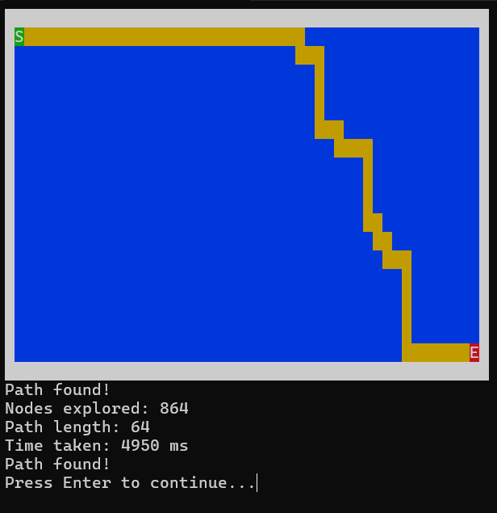
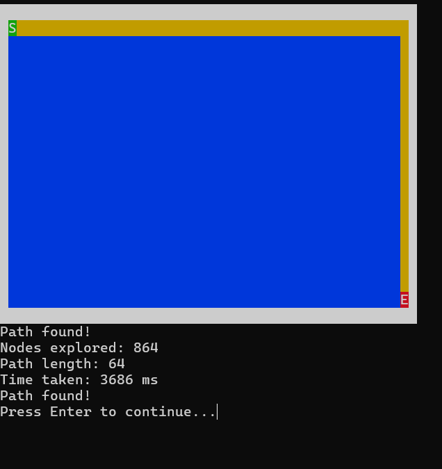

# Pathfinding Visualizer & Benchmark

A C++17 console application that **visualizes** Dijkstra, A\*, BFS and DFS on a 2D grid, and **benchmarks** them headlessly with seeded, reproducible scenarios, built-in correctness checks and CSV export.

Both modes call the same search code. The visualizer runs the search first, then replays the recorded exploration as an animation, so rendering and sleeping never count toward the measured search time.

## Features

**Interactive visualizer** (the default when you run it with no arguments)
- Animated exploration (blue) and final path (yellow) for all four algorithms.
- Random walls, a recursive-division maze generator, and random weighted terrain (sand, water, mountain).
- Adjustable animation speed.
- After each run it prints the metrics, including search-only time.
- Every random grid comes from a session seed. The menu shows the seed, and `--seed N` replays a session.

**Headless benchmark** (`--benchmark`)
- **Scenarios:** random walls at a set density, recursive-division mazes, and optional weighted terrain. Start and end can be placed reachable-only (the default), at random, or at the corners.
- **Same grids for every algorithm:** each seeded grid is generated once and shared by all algorithms. Paired per-grid ratios compare algorithms on exactly the same instances.
- **Two timings per run:** core search time and end-to-end call time, with timer calibration and flags for values near the timer's resolution.
- **Two-level statistics:** per-grid statistics over repeated runs, then distributions across independent grids.
- **Independent validation:** every run is checked against a reference solver that shares no code with the searches. Invalid runs are reported, excluded from statistics, and make the program exit with code 2.
- **Outputs:** four CSV files (per run, per grid, per scenario, paired), each with a JSON metadata sidecar. They are written crash-safely: existing files are only replaced when the run completes.

## Algorithms

All algorithms use 4-directional movement (up, right, down, left). Moving into a cell costs that cell's terrain cost.

| Terrain | Cost | Shown as |
|---|---|---|
| Empty | 1 | blank |
| Sand | 3 | `:` on bright yellow |
| Water | 5 | `~` on cyan |
| Mountain | 10 | `^` on magenta |
| Wall | impassable | white |

| Algorithm | Frontier | Guarantee |
|---|---|---|
| **Dijkstra** | binary heap keyed on distance | Minimum-cost path for any non-negative terrain costs. |
| **A\*** | binary heap keyed on f = g + h. Ties go to the smaller h, then insertion order | Minimum-cost path. h is Manhattan distance, which is admissible and consistent because every move costs at least 1. |
| **BFS** | FIFO queue | Fewest **moves**. It ignores terrain cost, so with terrain the path may not be the cheapest. |
| **DFS** | LIFO stack. A cell is marked visited when popped; neighbors are explored in up/right/down/left order | Finds *a* path if one exists. **Not optimal**: on random grids its paths are often several times longer than the shortest. |

Implementation notes:
- Heap entries hold a snapshot of their priority. The ordering never depends on mutable distance arrays; v1 had this bug, see [Changes from v1](#changes-from-v1).
- Stale heap and stack entries are skipped when popped and are never counted or re-expanded.
- Every algorithm tests for the goal when the goal is popped, so the metrics are comparable.
- Neighbor iteration does not allocate. The search state is flat arrays indexed by `row * cols + col`.

## Architecture

```
src/
  grid.h/.cpp        Domain model: cells, walls, terrain, start/end, seeded generation
                     (random walls, recursive-division maze, terrain), fingerprint,
                     platform-independent RNG
  search.h/.cpp      Dijkstra, A*, BFS, DFS, SearchMetrics, path validation.
                     No I/O and no sleeping. Optional expansion trace for the visualizer.
  visualizer.h/.cpp  ANSI rendering, animation (replays the trace), interactive menu.
                     Keeps v1's dijkstra/astar/bfs/dfs(Grid&, int) entry points.
  validation.h/.cpp  Independent oracle: reachability/fewest-moves BFS, Dial minimum cost,
                     per-run path and metric checks. Shares no code with search.cpp.
  benchmark.h/.cpp   Scenario generation (separate RNG streams, reachable placement), suites,
                     interleaved timed runs, per-grid and across-grid statistics, paired ratios
  report.h/.cpp      CSV writers (RFC 4180, empty fields for missing values), console tables
  metadata.h/.cpp    Timer calibration, build/environment facts, JSON sidecar
  output.h/.cpp      Crash-safe staged output files (write .partial, rename on success)
  cli.h/.cpp         Command-line parsing and validation (pure, unit-tested)
  main.cpp           Chooses interactive or benchmark mode; wires outputs and exit codes
cmake/GitInfo.cmake  Records the git commit / dirty state at every build
tests/test_main.cpp  Self-contained unit tests (no external framework)
tests/cli_checks.cmake  End-to-end checks of the executable (exit codes, outputs, overwrite safety)
```

`pathfinding_core` is a static library containing everything except rendering; the visualizer never runs the validation oracle. The `pathfinding` executable and the `pathfinding_tests` executable both link it.

## Building

Requires CMake 3.10 or newer and a C++17 compiler. CI builds on GCC (Ubuntu), Clang (macOS) and MSVC (Windows). Single-config generators default to a **Release** build, because benchmark timings from unoptimized builds are not meaningful.

**Linux / macOS**
```bash
cmake -S . -B build
cmake --build build -j
```

**Windows** (Visual Studio developer prompt, or any shell with CMake and MSVC)
```bat
cmake -S . -B build
cmake --build build --config Release
build\Release\pathfinding.exe
```
The interactive mode needs a terminal with ANSI escape support. Windows 10+ consoles and Windows Terminal work; the program enables virtual-terminal processing at startup.

Optional CMake flags:
- `-DPATHFINDING_SANITIZE=ON` builds with AddressSanitizer and UndefinedBehaviorSanitizer (GCC/Clang).
- `-DPATHFINDING_WERROR=ON` treats warnings as errors.

## Interactive usage

```bash
./build/pathfinding            # new random session seed each launch
./build/pathfinding --seed 7   # reproducible session
```

```
Pathfinding Visualizer (seed 7)
1. Dijkstra's Algorithm
2. A* Search
3. Breadth-First Search
4. Depth-First Search
5. Generate Random Walls
6. Clear Grid
7. Quit
8. Adjust Animation Speed
9. Generate Maze
10. Generate Random Terrain (weighted: ~ sand 3, W water 5, ^ mountain 10)
Enter your choice:
```

The grid is 20×50 with border walls. Start (green `S`) is at the top-left and end (red `E`) is at the bottom-right. After a run, the program prints metrics such as:

```
Path found!
Nodes discovered:   359
Nodes expanded:     353
Path length:        88 moves
Path cost:          223
Peak frontier size: 10
Search time:        0.078 ms core, 0.081 ms end-to-end (animation excluded)
```

Screenshots from v1 (same colors and layout; the v2 menu also shows the seed and option 10):

| Menu | Dijkstra | A\* | BFS | DFS |
|---|---|---|---|---|
|  |  |  |  |  |

## Benchmark usage

```bash
# Default: 10 independent 100x100 grids at 30% walls (seeds 42..51), reachable
# start/end, 12 timed runs of every algorithm on every grid
./build/pathfinding --benchmark --csv runs.csv

# Same, written out explicitly, with all four outputs
./build/pathfinding --benchmark --size 100x100 --density 30 --seed 42 --grids 10 --runs 12 \
    --csv runs.csv --grid-csv grid.csv --summary-csv summary.csv --paired-csv paired.csv

# A* against Dijkstra on 30 weighted-terrain grids
./build/pathfinding --benchmark --algorithm astar,dijkstra --terrain 30 --grids 30 --runs 12 --paired-csv paired.csv

# Unrestricted placement: corner-to-corner, unreachable instances included
./build/pathfinding --benchmark --placement corners --density 40 --grids 30

# Every preset scenario
./build/pathfinding --benchmark --suite all --csv runs.csv --summary-csv summary.csv --paired-csv paired.csv
```

Defaults: `--grids 10`, `--runs 12`, `--warmup 1`, `--seed 42`, `--placement reachable`, `--size 100x100`, `--density 30`. Run `--help` for every option.

Inputs are validated. Sides must be 3–10000, with at most 10,000,000 cells. The total number of timed runs (scenarios × grids × runs × algorithms) may be at most 2,000,000. Densities must be 0–100. The seed range `seed .. seed+grids−1` must fit in 64 bits. All output paths must be distinct. Unknown, duplicated and contradictory options are rejected.

Warnings are printed even with `--quiet` and are recorded in the metadata. The program warns about:
- `--grids 1`: one grid describes a single instance, not a scenario.
- A run count that is not a multiple of the number of algorithms: run-order positions are then not balanced.
- Seeds above 2^53 − 1: spreadsheets and JavaScript cannot represent them exactly.

**Exit status**

| Code | Meaning |
|---|---|
| 0 | success |
| 1 | usage or I/O error |
| 2 | at least one correctness check failed. The failing runs are still written to the per-run CSV and excluded from the statistics. |
| 3 | some grids could not be generated (see Reachability). The failures are listed on stderr and in the metadata. |

**Output safety**
- **Collision check:** for each output `PATH`, the program writes `PATH`, `PATH.partial`, `PATH.meta.json` and `PATH.meta.json.partial`.
  - All of these paths must be distinct across all outputs. This is checked while the arguments are parsed, before any file is opened.
  - `--csv results.csv --grid-csv results.csv.meta.json` is rejected with an error naming both paths.
  - Paths are compared after lexical normalization (`a.csv`, `./a.csv`, `dir/../a.csv` and absolute forms match), ignoring ASCII case on Windows and macOS. Symbolic links and hard links are not resolved.
- **Staged writing:** each output is written to `PATH.partial` and renamed over `PATH` only after the whole benchmark has finished. An existing file is therefore never truncated by a run that fails later.
- **Refusing to overwrite:** existing outputs, sidecars and leftover `.partial` files are refused without `--force`. A leftover `.partial` may hold rows from an interrupted run.
- **Cleanup on ordinary failures:** if an output cannot be opened, or a write fails, the staging files this run created are removed. Final files are never deleted. If only the final rename fails, the complete staging file is kept and its path is reported.
- **Fatal errors and interruptions:** the per-run CSV is streamed and flushed after every grid. If the benchmark aborts with a fatal error, the completed rows are kept in `runs.csv.partial` and the other staging files are removed. If the process is killed, staging files are left as they were.
- **No multi-file transaction:** outputs are committed one at a time. If a later commit fails, earlier outputs have already been replaced; the error says which file failed.

### Scenarios and suites

Grid sizes include the one-cell border wall.

| Suite | Scenarios | Placement |
|---|---|---|
| `baseline` | random 100×100, 30% walls | reachable |
| `density` | random 100×100 at 10, 20, 30, 40, 50% walls | reachable |
| `density-corners` | the same densities | corners: **mixed reachability** (the v1 design; kept as a workload that includes unreachable instances) |
| `size` | random 20×50, 50×100, 100×100, 200×200 at 30% | reachable |
| `size-corners` | the same sizes | corners: mixed reachability |
| `maze` | recursive-division mazes 51×51, 101×101, 201×201 | corners (mazes are always connected) |
| `terrain` | random 100×100, 20% walls, 30% of free cells weighted | reachable |
| `all` | all of the above without duplicates | 20 scenarios |

### Grid generation, placement and reachability

A grid is a pure function of (scenario, seed). It is built in three steps, each with its own RNG stream:

1. **Walls (stream 0, the seed itself).**
   - Random scenarios make each interior cell a wall with probability `density`.
   - Maze scenarios use recursive division.
   - Cells (1,1) and (rows−2, cols−2) are never walls, in every mode.
2. **Endpoints (stream 1, derived with splitmix64).**
   - Endpoints are chosen only among cells that are already open. No wall is removed or moved, and the requested density is never changed.
3. **Terrain (stream 2).**
   - Sand, water or mountain on free cells other than start and end.

Because the streams are separate, a given seed produces **identical walls in every placement mode and at every terrain density**. Terrain never moves the endpoints. Tests check both.

The three placement modes:

| Mode | Endpoints | Selection characteristics |
|---|---|---|
| `corners` | (1,1) → (rows−2, cols−2) | Unrestricted. Long diagonal problems, but a corner cell has only two open neighbors, so it is often sealed in. Measured over 200 grids at 100×100: solvable 98% at 10% walls, 87.5% at 20%, 45.5% at 30%, 1% at 40%. |
| `random` | uniform over distinct open interior cells | Unrestricted. Over the same 200 grids: solvable 100% at 10–20% walls, 96% at 30%, 38% at 40%. |
| `reachable` (default) | as `random`, but redrawn until both endpoints lie in the same 4-connected component (deterministic rejection sampling, at most 10,000 attempts; the attempt count is recorded) | Every instance solvable. This samples uniformly among connected pairs, so pairs inside large components dominate. Random endpoints are usually closer than opposite corners: on the 100×100, 30% baseline the mean path is about 56 moves, against about 200 corner-to-corner. Above roughly 40% walls, open space no longer forms one large connected region, so reachable instances sit inside small clusters and are tiny: at 50% the mean path is 12.6 moves. |

If no connected pair is found (for example 100% walls, or a very small grid), generation **fails explicitly**:
- the grid is not benchmarked;
- the failure is reported per seed, counted in `grids_generated` versus `grids_requested`, and recorded in the metadata;
- the program exits with code 3.

Unreachable instances remain available as a workload through `corners` and `random`, and through the `*-corners` suites.

#### Interpreting reachable placement

`reachable` is a **conditioned population**, not unrestricted endpoint placement. Each attempt draws an ordered pair of distinct open interior cells uniformly at random and keeps it only if both cells are in the same 4-connected component. Accepted pairs are therefore uniform over *connected* pairs. This has four consequences:

- **Large components dominate.** A component with *s* open cells contributes about *s*² of the connected pairs, so endpoints land mostly in the largest component and almost never in small pockets.
- **Obstacle density reshapes the population.**
  - At low densities almost every pair is connected, so the conditioning hardly matters and `reachable` behaves like `random`.
  - As density rises, more and more draws are rejected, and the accepted pairs are only those inside whatever connected regions survive.
  - Above about 40% walls there is no large component left: accepted pairs sit in small clusters, paths are short (12.6 moves on average at 50%), and searches are tiny.

  So across the `density` suite, path length and search size change for two reasons: harder grids, and a different population of start/end pairs.
- **Grids are filtered too, not just endpoints.** A grid where no connected pair is found within 10,000 attempts is not benchmarked; it is reported as a generation failure (exit code 3). Those grids are absent from the statistics.
- **The rejection count is a diagnostic.** `placement_attempts` in the CSVs shows how strongly a grid was filtered.

**`corners` and `reachable` are different benchmarks, not two samples of the same one.**
- `corners` asks: "how do the algorithms behave on a long diagonal problem, including when it is unsolvable?"
- `reachable` asks: "how do they behave on solvable problems drawn from this obstacle model?"

Both use the same walls for a given seed. But their endpoints, solvability, path lengths and search sizes differ, so their results should not be compared or pooled. The placement mode is part of every `scenario_id` (`..._corners`, `..._reachable`) to keep them apart. Both modes are kept on purpose.

### Timing methodology

Each timed run is one fresh, self-contained search call. That call records two times with `std::chrono::steady_clock`:

| Field | What it includes |
|---|---|
| `search_time_ms` (core) | From the moment the per-cell arrays are allocated and initialised until path reconstruction ends. Frontier containers (heap, queue, stack) start empty and grow during the search, so that growth *is* included. |
| `end_to_end_time_ms` | The whole call: allocating and initialising the per-cell arrays, the core search, path reconstruction, and **freeing** the arrays. |

Both come from the same execution, so `search_time_ms ≤ end_to_end_time_ms` always holds; validation checks it.

The difference is mostly O(cells) setup. Each search sets up per-cell arrays of 14 bytes per cell for Dijkstra and A\* (6 for DFS, 5 for BFS). On tiny searches that setup dominates. On the obs50-corners scenario, end-to-end time is about 10× core time, and the core time is below the timer floor.

Excluded from both: grid generation, reference validation, warm-up runs, rendering, progress output, record building, aggregation and CSV writing. Each timed run uses fresh memory, and no workspace is reused between runs.

**Run order:**
- After `--warmup` untimed runs per algorithm per grid, timed runs are interleaved. Run *r* executes every algorithm, with the order rotated by *r*.
- Each algorithm occupies each position equally often when `runs` is a multiple of the number of algorithms; otherwise a warning is printed.
- `order_position` is exported so order effects can be checked.

**Timer resolution:**
- At startup the program measures the clock's back-to-back overhead and smallest observable step. Here, under WSL2: about 34 ns and 30 ns.
- It flags any per-grid median core time below 100 × the larger of the two (3.4 µs here). Flagged values show `near_timer_floor=1` in the per-grid CSV, are counted in the summary, and are marked `*` in the console table.
- Treat flagged values as approximate. They are not excluded, but they are left out of the expansions-per-ms throughput metric.

### Statistics

Repeated runs on one grid only measure timing noise: the searches are deterministic. Only distinct grids are independent instances. Aggregation is therefore two-level.

**Level 1, per grid** (`--grid-csv`): for each (grid, algorithm), statistics over the valid runs.
- Times: median, mean, sample standard deviation, min and max, for both core and end-to-end time.
- Core-time coefficient of variation (stddev ÷ mean, for n ≥ 2): a noise indicator.
- The deterministic metrics, the reference optimum, and the cost ratio.

**Level 2, across grids** (`--summary-csv`, console): for each (scenario, algorithm), the distribution of the **per-grid medians**.
- Time distributions: median, mean, Q1, Q3 and IQR, with n = the number of grids, for core and end-to-end time. They are also given for solvable grids only (`*_solvable`), so unreachable instances in the mixed `*-corners` scenarios can be separated out.
- Counts: grids requested, generated, measured and solvable.
- Rates: solvability rate (reference) and success rate (the algorithm's own result).
- Metric means: nodes expanded and discovered, peak frontier entries, exploration ratio (expanded ÷ open cells), path length (grids where a path was found), and cost ratio (grids where it is defined).
- Noise and throughput: median within-grid CV, and median expansions per core ms (only grids above the timer floor).

**Paired comparisons** (`--paired-csv`, console):
- Every algorithm runs on the same grids, so each pair (a, b) is compared per grid as `ratio = median time(a) ÷ median time(b)`. Below 1 means a was faster.
- Reported: median, mean, Q1, Q3, IQR, geometric mean of the ratios, and the fraction of grids where a was faster. Both core and end-to-end time are covered.
- A grid is **excluded and counted, never substituted** if either side has no valid run, a median ≤ 0, or a different grid hash.

**Formulas and conventions:**
- Quantiles use linear interpolation (NumPy's default, R type 7). The standard deviation uses n − 1.
- `cost_ratio = path cost ÷ reference minimum cost`. It is defined only when a path was found and the minimum is > 0. 0/0 (start = end) is left empty, never reported as 1.0.
- Invalid runs are excluded from all statistics and counted as `invalid_runs`. A grid with no valid runs is not "measured".

### Validation

`src/validation.cpp` is an independent oracle that never calls the production search code.
- Reachability and fewest moves come from a BFS over (row, col) pairs on a `std::deque`.
- Minimum cost comes from Dial's bucket-queue algorithm.
- It has its own terrain-cost table; a test checks it against the cost model.
- Both reference results are computed once per grid, outside any timed region.

Every timed run is checked against the reference:

| Check | Requirement |
|---|---|
| Path structure | Starts at start, ends at end, stays in bounds, no walls, 4-adjacent steps, no repeated cell. |
| Recomputed values | Path length and path cost, recomputed independently, match the reported values. |
| Reachability | `pathFound` agrees with reachability. |
| Cost optimality | Dijkstra and A\*: path cost = reference minimum cost. |
| Move optimality | BFS: path length = fewest moves. BFS is not required to be cost-optimal, and DFS is not required to be optimal at all. |
| Bounds (all algorithms) | Path length ≥ fewest moves; path cost ≥ minimum cost. |
| Metric invariants | 1 ≤ discovered ≤ size of the start's component; expanded ≤ discovered; every path cell except the goal was expanded; 1 ≤ peak frontier ≤ 1 + 4·expanded; the BFS frontier never exceeds discovered; an unsuccessful search exhausted the start component. |
| Timing | Finite, non-negative, core ≤ end-to-end. |
| Determinism | Non-time metrics equal those of the first valid run on that grid. |
| Grid unchanged | The grid fingerprint is the same after all runs. |

A failed check marks the run invalid (`checks_passed=0`, with the reasons in `failure`) and makes the program exit with code 2. The tests check the oracle itself against a brute-force solver on 120 random grids.

As a mutation check, I made Dijkstra and A\*'s shared code ignore terrain. The old self-referencing checks would have accepted that. The new oracle reported `not cost-optimal: cost 274, reference minimum 141` and the run exited with code 2.

### Seeds and fingerprints

- Grid *i* of a scenario uses seed `base + i`, and overflow is rejected.
- The RNG uses only raw `std::mt19937_64` output, never `std::*_distribution`, whose output differs between standard libraries. Golden-value tests pin a corners grid and a reachable-placement grid with terrain.
- Seeds are written as exact decimal integers. Keep them below 2^53 if the CSV will be opened in Excel.
- `grid_hash` is a 64-bit FNV-1a fingerprint of the dimensions, endpoints and every cell, written as `0x` plus 16 hex digits.
  - Equal hashes mean, with high probability, identical grids and endpoints. It is not cryptographic.
  - It does **not** prove that the same program version, build, machine or timing conditions were used; the metadata records those.

**Paired-grid design:**
- Within a scenario, all algorithms share each grid, which is what makes paired ratios valid.
- Across scenarios, the same seed list is reused. Walls depend only on (seed, density, size, type), so related scenarios are coupled:
  - `terrain` has exactly the same walls as the 20% `density` scenario;
  - `density-corners` has the same walls as `density`;
  - for a given seed, the 10% walls are a subset of the 20% walls.
- This shared-randomness design reduces variance in cross-scenario comparisons, but scenarios are not independent samples of each other.

Running the same command twice gives CSVs that are identical in every column except the two timing columns. CI checks this on every platform.

### Metadata sidecar

Every CSV gets `PATH.meta.json`, written even with `--quiet`. It records:
- the format version and status (`complete`, `check_failures`, `generation_failures`);
- program version, git commit, and whether the working tree had uncommitted or untracked changes **at build time** (refreshed on every build);
- compiler, C++ standard and build type;
- OS, kernel release (shows WSL2), machine, CPU model, logical CPUs and a UTC timestamp;
- the timer calibration;
- the timing methodology, base seed, seed rule, grids, runs, warm-up count, RNG streams and every scenario's parameters;
- the validation summary, generation errors and warnings.

Anything the program cannot determine is written as `"unknown"`.

### Example output

Excerpt from `--suite all` with the defaults (10 grids × 12 runs), Release build, GCC 15.2, i5-1235U under WSL2. These numbers describe this machine and these instances only.

```
Scenario random_100x100_obs0.3_ter0_reachable
  grids: 10/10 generated, 10/10 solvable; 12 timed runs per algorithm per grid
  Times are per-grid medians summarised across grids (ms). Counts are means per grid.
  algorithm    solved   core median    core IQR   e2e median  noise CV    expanded  path len cost ratio  checks
  dijkstra      100%       0.2276*      0.3105       0.2309     0.074      2773.4      56.4      1.000      ok
  astar         100%       0.0229*      0.0548       0.0260     0.125       450.8      56.4      1.000      ok
  bfs           100%       0.0673*      0.0957       0.0682     0.084      2773.4      56.4      1.000      ok
  dfs           100%       0.0589*      0.0918       0.0600     0.098      2727.0    1191.2     29.651      ok
  Paired core-time ratio a/b on the same grids (< 1: a faster):
    dijkstra/astar    median 5.519  IQR 4.277-7.031  geomean 4.902  dijkstra faster on 0/10 grids
    dijkstra/bfs      median 3.331  IQR 3.261-3.388  geomean 3.336  dijkstra faster on 0/10 grids
    ...

Scenario random_100x100_obs0.2_ter0.3_reachable
  ...
  dijkstra      100%        0.4891      0.2297       0.4922     0.060      4339.4      89.6      1.000      ok
  astar         100%        0.2047      0.1548       0.2079     0.061      1264.1      91.0      1.000      ok
  bfs           100%        0.0943      0.0359       0.0953     0.054      4693.1      82.0      1.954      ok
  dfs           100%        0.1537      0.0901       0.1549     0.113      4444.4    2849.0     68.792      ok
```

How to read this:
- **`*` means some grids are near the timer floor.** With reachable placement a few endpoint pairs are close together, so those searches take only microseconds.
- **Dijkstra and BFS expand identical cells on unit-cost grids.** Dijkstra breaks ties FIFO, so the paired ratio of about 3.3 (tight IQR) is the cost of the heap.
- **The A\* advantage varies a lot between grids.** Dijkstra/A\* has a median ratio of 5.5 but an IQR of 4.3–7.0. Report the spread, not a single factor.
- **With terrain, BFS is fastest but solves a different problem.** Its paths cost about 2× the optimum.

These results do not establish that any algorithm is faster in general. They hold for these grid models, this implementation, and this environment.

## CSV format

All four files follow the same conventions:
- RFC 4180 quoting, C-locale numbers, a single header line, no comment lines.
- Values that do not apply are **empty fields**, never −1. Examples: path length when there is no path, the reference cost of an unreachable grid, an undefined ratio.
- Densities are exact round-trip fractions (`0.3`, `0.004`, `0.30000000000000004`). `scenario_id` embeds them the same way (e.g. `random_100x100_obs0.3_ter0_reachable`), so distinct configurations never share an id, even across concatenated files.
- Every file starts with the scenario columns: `scenario_id, scenario_type, rows, columns, obstacle_density, terrain_density, placement`.

| File | One row per | Main columns |
|---|---|---|
| `--csv` | timed run | algorithm, grid_index, seed, grid_hash, placement_attempts, start/end, passable_cells, reachable, run_index, order_position, path_found, nodes_discovered, nodes_expanded, path_length, path_cost, reference_min_cost, reference_min_moves, peak_frontier_entries, search_time_ms, end_to_end_time_ms, checks_passed, failure |
| `--grid-csv` | grid × algorithm | identity columns, reference values, runs, valid_runs, deterministic metrics, cost_ratio, search_ms_{median,mean,stddev,min,max}, search_cv, end_to_end_ms_{…}, near_timer_floor |
| `--summary-csv` | scenario × algorithm | grids_{requested,generated,measured}, solvable_grids, grids_solved, runs_per_grid, invalid_runs, solvability_rate, success_rate, {search_ms, end_to_end_ms, search_ms_solvable, end_to_end_ms_solvable}_{median,mean,q1,q3,iqr}, median_search_cv, grids_near_timer_floor, metric means, cost_ratio_grids, median_expansions_per_search_ms |
| `--paired-csv` | scenario × algorithm pair × timing | algorithm_a, algorithm_b, timing (`search` / `end_to_end`), grids_compared, grids_excluded, ratio_a_over_b_{median,mean,q1,q3,iqr,geomean}, a_faster_fraction |

```python
import pandas as pd
runs = pd.read_csv("runs.csv", dtype={"grid_hash": str})
grid = pd.read_csv("grid.csv", dtype={"grid_hash": str})
# per-grid medians are the independent observations:
grid.groupby(["scenario_id", "algorithm"]).search_ms_median.describe()
```

All four files have been checked to load in pandas with every metric column numeric. Missing values become `NaN`, never −1.

## Testing

```bash
cmake --build build
ctest --test-dir build --output-on-failure      # or: cd build && ctest
./build/pathfinding_tests [name-filter]          # unit tests directly
```

`tests/test_main.cpp` has 63 test cases and needs no external framework. It covers:
- **Algorithm correctness:** start = end, a 1×1 grid, a straight corridor with exact metric values, empty grids of several sizes (path length = Manhattan distance), paths with turns, a narrow corridor, an unreachable destination, a walled-in start and a walled-in destination, terrain avoidance (Dijkstra and A\* go around mountains; BFS goes through them), and stale heap entries.
- **Oracle comparison:** 150 random grids of different sizes, densities, terrain and placements. BFS, Dijkstra and A\* are compared exactly against an independent brute-force (Bellman-Ford-style) solver, and DFS is checked for validity and reachability.
- **Invariants checked on every search:** expanded ≤ discovered ≤ passable cells; no cell is expanded twice; the trace length equals `nodesExpanded`; the path is valid and simple; `pathLength` and `pathCost` agree with the path; when there is no path, the whole connected region was expanded.
- **Generation:** reproducibility, a golden fingerprint, wall density near the requested value, every maze cell connected, start and end never walled.
- **Benchmark, reporting and CLI:**
  - identical grids across algorithms and re-run reproducibility; every preset suite passes validation;
  - per-grid and across-grid statistics, quantiles, paired ratios and their exclusion rules, division-by-zero guards;
  - balanced run order, config validation and warnings;
  - CSV escaping, empty-field missing values, hash and density formats, rectangular and numeric-only columns;
  - exact scenario IDs (0% versus 0.4% stay separate);
  - CLI parsing, including 33 invalid-input cases.
- **Generation:** placement modes share identical walls; terrain does not move endpoints; reachable placement is always connected and deterministic; unrestricted placement keeps unreachable instances; generation failures are reported explicitly; golden fingerprints.
- **Independent validation:**
  - the reference solver against the brute-force oracle on 120 grids;
  - correct results accepted on 250×250 grids;
  - tampered results (length, cost, adjacency, start, repeats, bounds, reachability, counters, timing, optimality per algorithm) rejected.
- **Output and metadata:** staged files leave the original untouched until commit; overwrite protection includes sidecars; the metadata has the required fields and balanced JSON.

CTest also runs the real executable:
- it checks `--help` and that bad arguments are rejected;
- it runs a `--suite all` smoke benchmark with all four outputs;
- `tests/cli_checks.cmake` checks exit codes 0/1/3, sidecars written under `--quiet`, no leftover `.partial` files, refusal to overwrite without `--force` (existing file byte-identical), `--force` replacement, failure on an unwritable path, and the warnings.

**CI** (`.github/workflows/build.yml`) builds and runs `ctest` on Ubuntu/GCC, macOS/Clang and Windows/MSVC. It also diffs two benchmark runs for reproducibility (all columns except the two timing columns), and runs a separate Linux job with AddressSanitizer and UndefinedBehaviorSanitizer. Warnings are errors on GCC and Clang.

## Limitations

**Benchmark methodology**
- **The environment is not controlled.** Runs are single-threaded wall-clock time, with no CPU pinning, frequency locking or isolation. The example numbers come from a laptop under WSL2, which adds virtualization noise. Outliers are not removed; medians and IQRs limit their influence. The metadata records the environment but cannot remove its effects.
- **Small searches are near the timer floor.** Sub-microsecond and low-microsecond values are close to the calibrated floor and are flagged. Core time still includes the frontier containers' growth.
- **No workspace reuse is measured.** Each timed run allocates fresh memory, so end-to-end time includes allocator behavior.
- **Interleaving cools the caches.** Interleaving protects against drift, but each timed run starts with partly cold caches. This is a deliberate trade-off.
- **Placement modes have different selection effects.** Reachable placement changes the problem distribution (shorter paths than corners; tiny clusters above about 40% walls). Results from different placement modes are not interchangeable.
- **Scenarios share seeds.** This couples related scenarios (see Seeds and fingerprints). Cross-scenario statistics are paired, not independent.
- **BFS and DFS solve a different problem on terrain grids.** They ignore terrain costs, so their times there should not be read as competing with Dijkstra and A\*.
- **Perfect mazes have exactly one path.** The maze scenario only measures exploration order and overhead.
- **`peak_frontier_entries` counts container entries,** including stale duplicates (Dijkstra, A\*, DFS; BFS has none). It reflects memory use, not the number of distinct pending cells.
- **The reference solvers are independent of the searches, not of the grid model.** Both use the same `Grid` contents and the same movement rules.

**Project**
- Movement is 4-directional only. Terrain costs are fixed (1/3/5/10) and apply when *entering* a cell.
- The interactive grid is fixed at 20×50 with fixed start and end positions. Walls and terrain are generated, not hand-drawn.
- Memory and scale: a 3162×3162 grid with terrain (about 10M cells, the CLI limit) ran all four algorithms in 152 MB peak RSS. The 2,000,000-run cap on tiny grids completed in 6.4 s at 53 MB, because per-run records are streamed rather than kept.
- The screenshots are from v1. The interactive mode is tested by hand and through scripted stdin only.

## Future improvements

- 8-directional movement with an octile-distance heuristic.
- More algorithms behind the same interface: greedy best-first, bidirectional BFS, Jump Point Search.
- Loading grids from text files, such as the Moving AI benchmark maps.
- A Python/pandas notebook that plots the CSV output.
- An optional reused-workspace timing mode, to isolate allocator effects from the search.
- Bootstrap confidence intervals for paired ratios when many grids are available.

## Changes from v1

- **Dijkstra and A\*:** the priority-queue comparator read the live `distance`/`f` arrays, which change after insertion and corrupt the heap order. There were no stale-entry checks, so cells were re-expanded and "nodes explored" was inflated. Fixed with priority snapshots and stale-entry skipping.
- **Terrain:** `SAND` and `START` were both `'S'`, terrain was never used in search costs, and visited marks overwrote cell contents. Terrain now has real costs used by Dijkstra and A\*; overlays are kept separate from the grid.
- **Maze generator:** it ignored wall and passage parity, so passages could be walled off and mazes could be disconnected. It also drew over existing walls. The maze now always clears the grid first and every open cell is connected (this is tested).
- **Randomness:** `rand()` with `time()` became seeded, platform-independent generation.
- **Timing:** it was integer milliseconds and included rendering and `sleep_for`. It now covers the search only, at sub-microsecond resolution.
- **Code removed:** the unused `smoothPath()`, which collapsed any path to two points, and the per-call vector allocation in `getNeighbors`.
- **CI:** it previously ran a non-existent `./PathfindingVisualizer` binary and no tests. It now builds and tests on three platforms.
- **Benchmark methodology (v2.1):**
  - reachable placement and independent RNG streams;
  - defaults of 10 grids × 12 runs;
  - two-level statistics and paired ratios;
  - an independent validation oracle;
  - separate core and end-to-end timing, plus timer calibration;
  - exact scenario IDs and empty-field CSV missing values;
  - staged output files with metadata sidecars.

## License

[MIT License](LICENSE)
