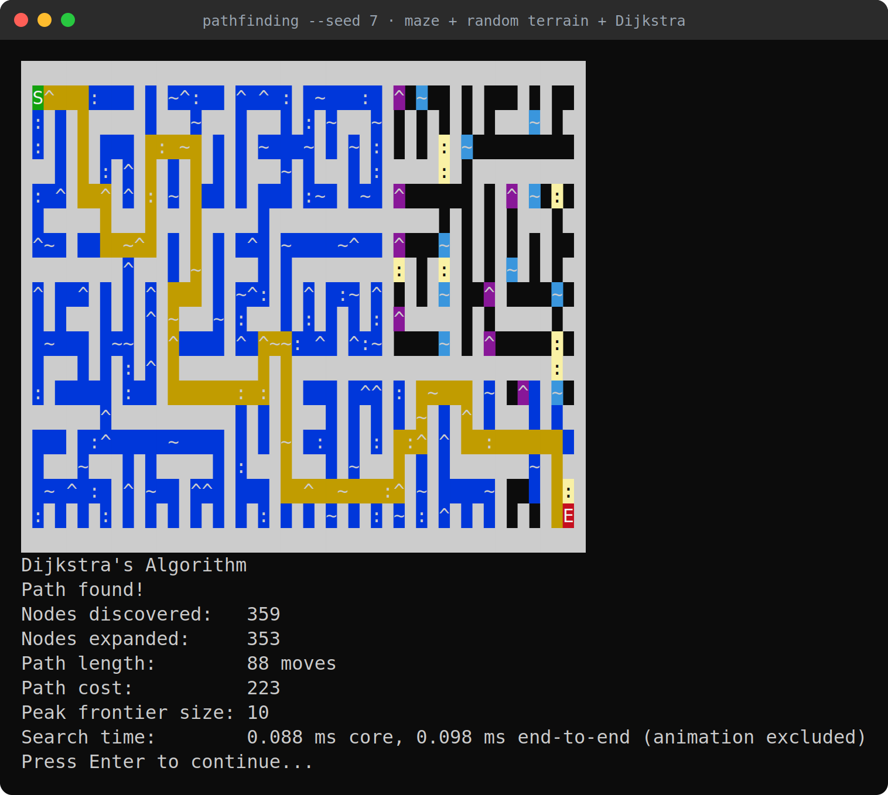
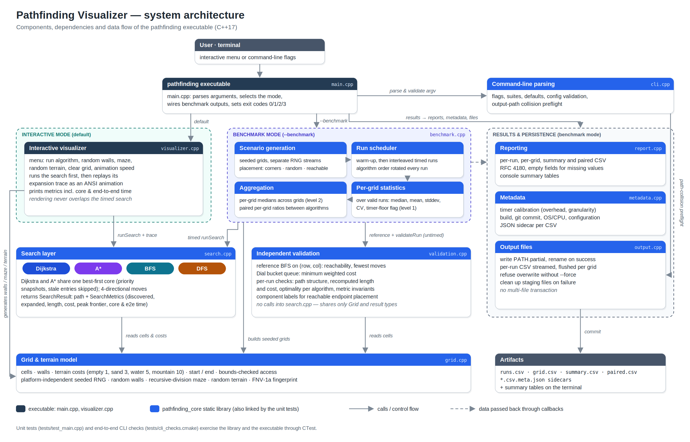
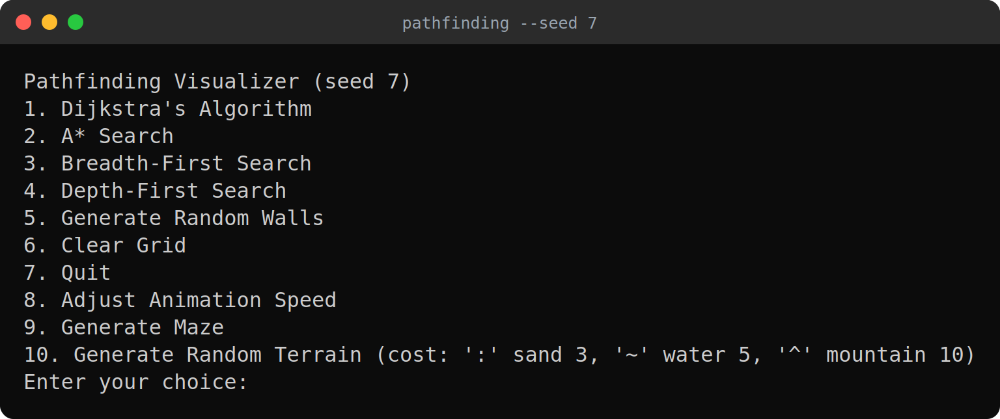
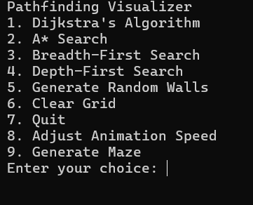
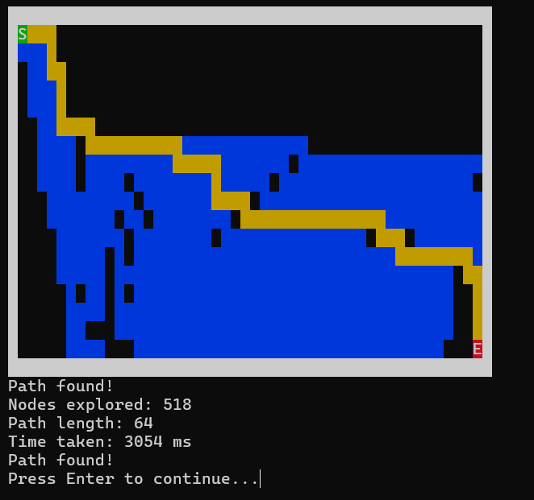
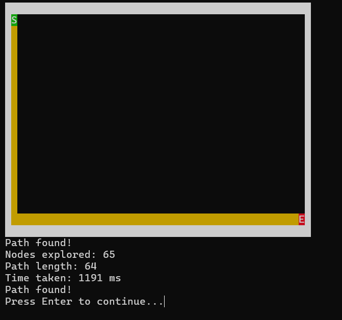

# Pathfinding Visualizer

[](https://github.com/Nitin2489/pathfinding-visualizer/actions/workflows/build.yml)

[](LICENSE)

A C++17 terminal application that **animates** Dijkstra, A\*, BFS and DFS on a 2D grid, and **benchmarks** them headlessly on seeded, reproducible workloads.

Both modes run the same search code. Every benchmark result is checked by an independent correctness oracle before it is counted.

<p align="center">
  
</p>
<p align="center"><sub>Dijkstra on a maze with random terrain: explored cells in blue, the cheapest path in yellow, metrics below.<br>
Rendered from the program's captured terminal output (<a href="docs/diagrams/render_terminal.py"><code>docs/diagrams/render_terminal.py</code></a>).</sub></p>

## Features

**Interactive visualizer**
- Step-by-step animation of the search, then the final path.
- Random walls, recursive-division mazes and weighted terrain.
- Per-run metrics, with search time measured separately from the animation.
- Sessions are reproducible with `--seed`.

**Benchmark mode** (`--benchmark`)
- **Workloads:** seeded random-wall, maze and terrain workloads with three endpoint-placement strategies.
- **Identical grids:** every algorithm runs on the same grids, so per-grid paired comparisons are valid.
- **Timing:** two measurements per run (core search, end-to-end call), with a timer-floor diagnostic.
- **Statistics:** two levels, per grid over repeated runs and then across independent grids.
- **Validation:** an independent reference solver checks paths, optimality and metric invariants.
- **Outputs:** four CSV reports plus JSON metadata, written through staged, collision-checked output files.

## Architecture

<p align="center">
  
</p>

- **Structure:** `main.cpp` and `visualizer.cpp` form the executable. All other modules live in the `pathfinding_core` static library, which the unit tests also link.
- **Interactive mode:** the visualizer runs a search to completion, then replays the recorded expansion trace.
- **Benchmark mode:**
  - the engine generates each grid once and times every algorithm on that same grid;
  - every run is checked against `validation.cpp`, which shares no code with `search.cpp`;
  - results are handed to the reporting, metadata and output modules.

## Algorithms

Movement is 4-directional. Entering a cell costs its terrain cost: empty 1, sand `:` 3, water `~` 5, mountain `^` 10. Walls are impassable.

| Algorithm | Frontier | Guarantee |
|---|---|---|
| **Dijkstra** | binary heap on path cost | minimum-cost path |
| **A\*** | binary heap on cost + Manhattan distance | minimum-cost path (the heuristic never overestimates, because every move costs ≥ 1) |
| **BFS** | FIFO queue | fewest moves; ignores terrain cost |
| **DFS** | LIFO stack | finds *a* path if one exists; not optimal |

All four share the same metric definitions: cells discovered, cells expanded, path length, path cost, peak frontier size, and core and end-to-end time. Stale queue entries are skipped and never counted.

## Building

Requires CMake ≥ 3.10 and a C++17 compiler. CI builds with GCC, Clang and MSVC. Single-configuration builds default to Release.

```bash
cmake -S . -B build
cmake --build build -j            # Windows: cmake --build build --config Release
```

Optional flags:
- `-DPATHFINDING_WERROR=ON` treats warnings as errors.
- `-DPATHFINDING_SANITIZE=ON` builds with AddressSanitizer and UndefinedBehaviorSanitizer (GCC/Clang).

## Interactive visualizer

```bash
./build/pathfinding            # random session seed (shown in the menu)
./build/pathfinding --seed 7   # reproducible session
```



- **Options 1–4** run an algorithm on the 20×50 grid, from the top-left `S` to the bottom-right `E`.
- **Options 5, 9 and 10** generate random walls, a maze or random terrain.
- **Option 6** clears the grid, and **option 8** sets the animation delay.

The terminal must support ANSI colours. Windows 10+ consoles and Windows Terminal do; the program enables escape-sequence handling (virtual-terminal processing) at startup.

<details>
<summary>Screenshots from version 1 (older menu and metrics output)</summary>

| Menu | Dijkstra | A\* | BFS | DFS |
|---|---|---|---|---|
|  |  |  |  |  |

</details>

## Benchmark quick start

```bash
# 10 seeded 100x100 grids, 30% walls, solvable start/end pairs, 12 timed runs per algorithm per grid
./build/pathfinding --benchmark --csv runs.csv --summary-csv summary.csv --paired-csv paired.csv

# Every preset scenario: density, size, maze, terrain, corner-placement workloads
./build/pathfinding --benchmark --suite all --grid-csv grid.csv --summary-csv summary.csv

# Compare two algorithms on weighted terrain
./build/pathfinding --benchmark --algorithm astar,dijkstra --terrain 30 --grids 30 --paired-csv paired.csv
```

| Output | Contents |
|---|---|
| `--csv` | one row per timed run (streamed) |
| `--grid-csv` | per-grid statistics over repeated runs |
| `--summary-csv` | per-scenario distributions across grids |
| `--paired-csv` | per-grid time ratios between algorithms |
| `*.meta.json` | build, git revision, environment, timer calibration and configuration |

**Exit codes:**
- `0`: success.
- `1`: usage or I/O error.
- `2`: a correctness check failed.
- `3`: a grid could not be generated.

Run `--help` for all options.

<p align="center">
  
</p>

Workload generation, reachability, timing, statistics and the CSV schema are documented in **[docs/benchmark-methodology.md](docs/benchmark-methodology.md)**. Results describe the measured machine and workloads only; they are not general performance claims.

## Testing

```bash
ctest --test-dir build --output-on-failure    # everything
./build/pathfinding_tests [name-filter]        # unit tests only
```

- **Unit tests (66):**
  - searches checked against a brute-force solver, and the reference solver checked against it too;
  - validation, generation, statistics, CSV, CLI and output-safety cases.
- **End-to-end checks:** exercise the real executable (exit codes, overwrite protection, collision rejection, cleanup).
- **Smoke benchmark:** must pass every correctness check.
- **CI:** runs everything on Linux, macOS and Windows, compares two benchmark runs for reproducibility, and has a sanitizer job.

Details: [methodology §14](docs/benchmark-methodology.md#14-how-the-framework-itself-is-tested).

## Limitations and roadmap

**Limitations**
- 4-directional movement only. Terrain costs are fixed.
- The interactive grid is 20×50 with fixed start and end positions.
- Benchmarks run in an uncontrolled environment: single-threaded wall-clock time, no CPU pinning. Microsecond-scale results are flagged as near the timer floor.
- BFS and DFS ignore terrain. Corner and reachable placement are different workloads ([details](docs/benchmark-methodology.md#13-limitations)).

**Roadmap**
- 8-directional movement with an octile heuristic.
- Greedy best-first search, bidirectional BFS and Jump Point Search.
- Loading standard benchmark maps (Moving AI).
- A reused-workspace timing mode.
- Confidence intervals for paired ratios.
- A notebook for plotting the CSV output.

## Further reading

- [Benchmark methodology](docs/benchmark-methodology.md): workloads, timing, validation, statistics, CSV schema, output safety.
- [Changes from v1](docs/changes-from-v1.md): defects fixed in the rewrite.
- **Regenerating the images:** run `python3 docs/diagrams/render_diagrams.py` and `python3 docs/diagrams/render_terminal.py build/pathfinding`. Both need CairoSVG.

## License

[MIT](LICENSE)
