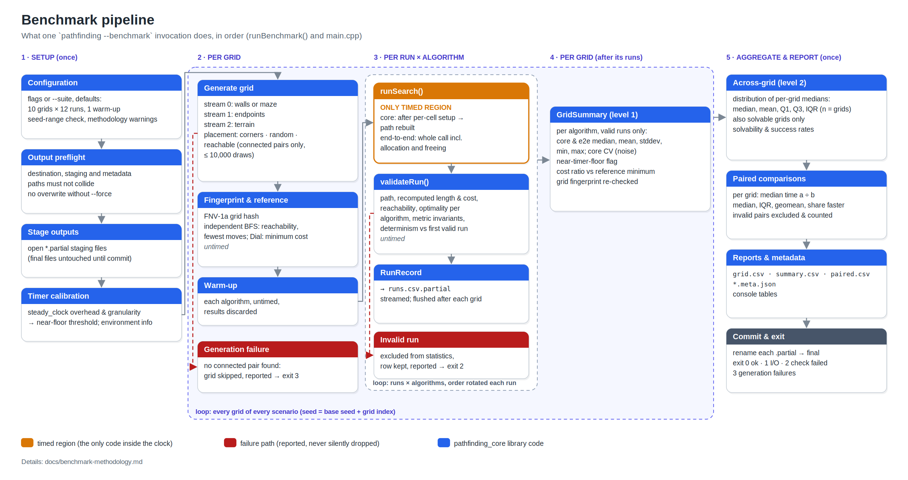

# Benchmark methodology

This document describes how `pathfinding --benchmark` generates workloads, measures searches, validates results, aggregates statistics and writes its outputs. It describes the code as implemented. Each statement can be traced to `src/benchmark.cpp`, `src/search.cpp`, `src/validation.cpp`, `src/report.cpp`, `src/metadata.cpp`, `src/output.cpp` or `src/cli.cpp`.



**Contents**
1. [Running a benchmark](#1-running-a-benchmark)
2. [Scenarios and suites](#2-scenarios-and-suites)
3. [Grid generation](#3-grid-generation)
4. [Endpoint placement and reachability](#4-endpoint-placement-and-reachability)
5. [Seeds, reproducibility and fingerprints](#5-seeds-reproducibility-and-fingerprints)
6. [Metrics](#6-metrics)
7. [Timing](#7-timing)
8. [Independent validation](#8-independent-validation)
9. [Aggregation](#9-aggregation)
10. [Paired comparisons](#10-paired-comparisons)
11. [Interpreting results](#11-interpreting-results)
12. [Outputs: CSV, metadata and file safety](#12-outputs-csv-metadata-and-file-safety)
13. [Limitations](#13-limitations)
14. [How the framework itself is tested](#14-how-the-framework-itself-is-tested)

---

## 1. Running a benchmark

```bash
# Default: 10 independent 100x100 grids at 30% walls (seeds 42..51), reachable
# start/end, 12 timed runs of every algorithm on every grid
./build/pathfinding --benchmark --csv runs.csv

# Same, written out explicitly, with all four outputs
./build/pathfinding --benchmark --size 100x100 --density 30 --seed 42 --grids 10 --runs 12 \
    --csv runs.csv --grid-csv grid.csv --summary-csv summary.csv --paired-csv paired.csv

# A* against Dijkstra on 30 weighted-terrain grids
./build/pathfinding --benchmark --algorithm astar,dijkstra --terrain 30 --grids 30 --runs 12 --paired-csv paired.csv

# Unrestricted placement: corner to corner, unreachable instances included
./build/pathfinding --benchmark --placement corners --density 40 --grids 30

# Every preset scenario
./build/pathfinding --benchmark --suite all --csv runs.csv --summary-csv summary.csv --paired-csv paired.csv
```

### Options

| Option | Default | Meaning |
|---|---|---|
| `--algorithm LIST` | `all` | `all` or a comma list of `dijkstra,astar,bfs,dfs` |
| `--scenario TYPE` | `random` | `random` (random walls) or `maze` (recursive division) |
| `--size RxC` | `100x100` | rows × columns, including the one-cell border wall |
| `--density PCT` | `30` | probability that an interior cell is a wall (random scenarios) |
| `--terrain PCT` | `0` | percentage of free cells given weighted terrain |
| `--placement P` | `reachable` | `reachable`, `random` or `corners` ([§4](#4-endpoint-placement-and-reachability)) |
| `--suite NAME` | none | a preset set of scenarios ([§2](#2-scenarios-and-suites)); cannot be combined with the scenario options above |
| `--seed N` | `42` | base seed; grid *i* uses seed `N + i` |
| `--grids N` | `10` | independent grids per scenario |
| `--runs N` | `12` | timed runs per algorithm per grid |
| `--warmup N` | `1` | untimed runs per algorithm per grid, discarded |
| `--csv`, `--grid-csv`, `--summary-csv`, `--paired-csv` | none | outputs ([§12](#12-outputs-csv-metadata-and-file-safety)) |
| `--force` | off | allow replacing existing outputs |
| `--quiet` | off | no progress or metadata on the terminal; files and warnings are unaffected |

`12` runs divides evenly among 1, 2, 3 or 4 algorithms, which keeps run-order positions balanced ([§7](#7-timing)).

### Validation of inputs

The following are rejected:

| Input | Rule |
|---|---|
| Grid size | each side must be 3–10,000, with at most 10,000,000 cells |
| Total work | at most 2,000,000 timed runs (scenarios × grids × runs × algorithms) |
| Densities | 0–100 |
| Seed range | `seed … seed+grids−1` must fit in 64 bits |
| Options | unknown, duplicated or contradictory options (e.g. `--density` with `--scenario maze`, `--size` with `--suite`) |
| Output paths | must not collide ([§12](#output-safety)) |

### Warnings

Warnings are printed to stderr even with `--quiet` and are recorded in the metadata. The program warns about:
- `--grids 1`: one grid describes a single instance, not a scenario.
- A run count that is not a multiple of the number of algorithms: run-order positions are then unbalanced.
- Seeds above 2^53 − 1: spreadsheets and JavaScript cannot represent them exactly.

### Exit status

| Code | Meaning |
|---|---|
| 0 | success |
| 1 | usage or I/O error |
| 2 | at least one correctness check failed. The failing runs are written to the per-run CSV and excluded from the statistics. |
| 3 | some grids could not be generated ([§4](#4-endpoint-placement-and-reachability)); listed on stderr and in the metadata |

## 2. Scenarios and suites

| Suite | Scenarios | Placement |
|---|---|---|
| `baseline` | random 100×100, 30% walls | reachable |
| `density` | random 100×100 at 10, 20, 30, 40, 50% walls | reachable |
| `density-corners` | the same densities | corners: **mixed reachability**. This was the original design, kept as a workload that includes unreachable instances. |
| `size` | random 20×50, 50×100, 100×100, 200×200 at 30% | reachable |
| `size-corners` | the same sizes | corners: mixed reachability |
| `maze` | recursive-division mazes 51×51, 101×101, 201×201 | corners (mazes are always connected) |
| `terrain` | random 100×100, 20% walls, 30% of free cells weighted | reachable |
| `all` | all of the above, duplicates removed | 20 scenarios |

Each scenario has an exact identifier such as `random_100x100_obs0.3_ter0_reachable`. Densities appear as shortest round-trip decimal fractions, so distinct configurations never share an identifier ([§12](#12-outputs-csv-metadata-and-file-safety)).

## 3. Grid generation

A grid is a pure function of (scenario, seed). It is built in three steps, each drawing from its own RNG stream:

1. **Walls (stream 0, the seed itself).**
   - Random scenarios make each interior cell a wall with probability `density`.
   - Maze scenarios use recursive division with walls on even and passages on odd coordinates, so every open cell stays connected.
   - Cells (1,1) and (rows−2, cols−2) are never walls, in any mode.
2. **Endpoints (stream 1, derived with splitmix64).**
   - Endpoints are chosen only among cells that are already open. No wall is removed or moved, and the requested density is never changed.
3. **Terrain (stream 2).**
   - Sand (cost 3), water (5) or mountain (10), with equal probability, on free cells other than start and end.

Because the streams are separate:
- a given seed produces **identical walls in every placement mode and at every terrain density**;
- adding terrain never moves the endpoints.

Both properties are covered by tests.

The RNG uses only the raw `std::mt19937_64` output, whose sequence the C++ standard fixes. Integers come from rejection sampling and reals from the top 53 bits. The `std::*_distribution` classes are never used, because their output differs between standard libraries. Golden-value tests pin the fingerprints of a corners grid and a reachable-placement grid with terrain.

## 4. Endpoint placement and reachability

| Mode | Endpoints | Selection characteristics |
|---|---|---|
| `corners` | (1,1) → (rows−2, cols−2) | **Unrestricted.** Long diagonal problems, but a corner cell has only two open neighbours, so it is often sealed in. |
| `random` | uniform over distinct open interior cells | **Unrestricted.** |
| `reachable` (default) | as `random`, redrawn until both endpoints lie in the same 4-connected component | **Conditioned on solvability.** Deterministic rejection sampling, at most 10,000 attempts; the attempt count is recorded as `placement_attempts`. |

Measured solvable rates on 100×100 grids, 200 seeds each:

| Wall density | `corners` | `random` |
|---|---|---|
| 10% | 98% | 100% |
| 20% | 87.5% | 100% |
| 30% | 45.5% | 96% |
| 40% | 1% | 38% |

If `reachable` finds no connected pair (for example at 100% walls, or on a very small grid), generation **fails explicitly**:
- the grid is not benchmarked;
- the failure is reported per seed and counted in `grids_generated` versus `grids_requested`;
- it is recorded in the metadata;
- the program exits with code 3.

Unreachable instances stay available as a workload through `corners`, `random` and the `*-corners` suites.

### Interpreting reachable placement

`reachable` is a **conditioned population**, not unrestricted endpoint placement. Each attempt draws an ordered pair of distinct open interior cells uniformly at random and keeps it only if both cells are in the same 4-connected component. The component labels come from the validation module. Accepted pairs are therefore uniform over *connected* pairs. This has four consequences:

- **Large components dominate.** A component with *s* open cells contributes about *s*² of the connected pairs, so endpoints land mostly in the largest component and almost never in small pockets.
- **Obstacle density reshapes the population.**
  - At low densities almost every pair is connected, so `reachable` behaves like `random`.
  - As density rises, more draws are rejected, and the accepted pairs come only from whatever connected regions remain.
  - Above about 40% walls no large component is left: accepted pairs sit in small clusters and searches are tiny. On the 100×100 grids the mean path is 12.6 moves at 50% walls, against about 56 at 30%.

  Across the `density` suite, path length and search size therefore change for two reasons: harder grids, and a different population of start/end pairs.
- **Grids are filtered too, not just endpoints.** Grids without a connected pair within 10,000 attempts are reported as generation failures and are absent from the statistics.
- **The rejection count is a diagnostic.** `placement_attempts` shows how strongly a grid was filtered.

**`corners` and `reachable` are different benchmarks, not two samples of the same one.**
- `corners` asks: "how do the algorithms behave on a long diagonal problem, including when it is unsolvable?" The mean path on the 100×100, 30% grids is about 197 moves.
- `reachable` asks: "how do they behave on solvable problems drawn from this obstacle model?"

Both use the same walls for a given seed. But their endpoints, solvability, path lengths and search sizes differ, so their results should not be compared or pooled. The placement mode is part of every `scenario_id` to keep them apart.

## 5. Seeds, reproducibility and fingerprints

- **Seeds:** grid *i* of a scenario uses seed `base + i`, and overflow is rejected. Seeds are written as exact decimal integers; keep them below 2^53 if the CSV will be opened in Excel.
- **One grid object per seed:** each grid is generated once and used, as one `const` object, by every algorithm and every run. Its fingerprint is recomputed after the runs to confirm it was not changed.
- **`grid_hash`:** a standard 64-bit FNV-1a hash of the dimensions, start, end and every cell, written as `0x` plus 16 hex digits.
  - Equal hashes mean, with high probability, identical grids and endpoints. It is not cryptographic.
  - It does **not** show that the same program version, build, machine or timing conditions were used. The metadata records those ([§12](#metadata-sidecar)).
- **Re-running:** running the same command twice gives CSVs that are identical in every column except the two timing columns. CI checks this on Linux, macOS and Windows.

**Paired-grid design:**
- Within a scenario, all algorithms share each grid; this is what makes paired comparisons valid ([§10](#10-paired-comparisons)).
- Across scenarios, the same seed list is reused, and walls depend only on (seed, density, size, type). Related scenarios are therefore coupled:
  - `terrain` has exactly the same walls as the 20% `density` scenario;
  - `density-corners` has the same walls as `density`;
  - for a given seed, the 10% walls are a subset of the 20% walls.
- This shared-randomness design reduces variance in cross-scenario comparisons, but the scenarios are not independent samples of each other.

## 6. Metrics

All four algorithms define the per-search metrics in the same way (`src/search.h`).

| Metric (CSV column) | Definition |
|---|---|
| `path_found` | A start → end path was found. |
| `nodes_discovered` | Unique cells ever inserted into the frontier, **start included**. Re-insertions count once. |
| `nodes_expanded` | Unique cells whose neighbours were examined. Stale queue or stack entries are skipped and never counted. The goal is **not** counted, because the search stops when it is popped. When there is no path, this equals the size of the start's component. |
| `path_length` | Moves on the returned path; 0 when start = end; empty when there is no path. |
| `path_cost` | Sum of the entry costs of every cell after the start (empty 1, sand 3, water 5, mountain 10). Equals `path_length` without terrain; empty when there is no path. |
| `peak_frontier_entries` | Most entries ever held by the frontier container (heap, queue or stack), **including stale duplicates**. It reflects memory use; BFS never holds duplicates, while Dijkstra, A\* and DFS can. |
| `search_time_ms`, `end_to_end_time_ms` | See [§7](#7-timing). |

Optimality differs by algorithm:
- **Dijkstra and A\*** return a minimum-cost path. A\* uses the Manhattan distance, which never overestimates and stays consistent because every move costs at least 1.
- **BFS** returns a minimum-*move* path and ignores terrain.
- **DFS** returns *a* path, with no optimality guarantee.

Implementation notes (`src/search.cpp`):
- **Heap ordering:** heap entries store a snapshot of their priority, so the heap order never depends on mutable distance arrays.
- **Tie-breaking:** Dijkstra breaks ties in insertion (FIFO) order. A\* prefers the smaller heuristic, then insertion order.
- **DFS order:** DFS marks a cell visited when it is popped and explores neighbours in up, right, down, left order. Its visit order and parent links equal those of recursive DFS (this is tested). The price is stale duplicate stack entries, which `peak_frontier_entries` counts.
- **Goal test:** every algorithm tests for the goal when the goal is popped, so the counters are comparable.
- **Memory:** search state lives in flat per-cell arrays indexed by `row * cols + col`, and neighbour iteration does not allocate.

## 7. Timing

Each timed run is one fresh, self-contained search call. The call records two durations with `std::chrono::steady_clock`:

| Field | What it includes |
|---|---|
| `search_time_ms` (core) | From the moment the per-cell arrays are allocated and initialised until path reconstruction ends. Frontier containers start empty and grow during the search, so that growth *is* included. |
| `end_to_end_time_ms` | The whole call: allocating and initialising the per-cell arrays, the core search, path reconstruction, and freeing the arrays. |

Both come from the same execution, so `search_time_ms ≤ end_to_end_time_ms` always holds; validation checks it.

The gap between the two is mostly O(cells) setup: 14 bytes per cell for Dijkstra and A\*, 6 for DFS and 5 for BFS. On tiny searches that setup dominates. On the 100×100, 50%-walls corners scenario, end-to-end time is about 10× core time.

**Excluded from both:** grid generation, reference validation, warm-up runs, rendering, progress output, record building, aggregation and CSV writing. No working memory is reused between runs.

**Warm-up and run order:**
1. For each grid, every algorithm first runs `--warmup` times untimed; those results are discarded.
2. Timed runs are then interleaved: run *r* executes every algorithm, with the order rotated by *r*.
3. Each algorithm occupies each position equally often when `runs` is a multiple of the number of algorithms; otherwise a warning is printed.
4. `order_position` is exported so order effects can be checked.

Interleaving protects against slow drift such as frequency or thermal changes. The cost is that each run starts with partly cold caches.

**Timer floor:**
- At startup the program measures the clock's back-to-back overhead and the smallest observable step. On the reference machine under WSL2 these were about 34 ns and 30 ns.
- Any per-grid median core time below 100 × the larger of the two (3.4 µs there) is flagged:
  - `near_timer_floor=1` in the per-grid CSV;
  - counted in `grids_near_timer_floor`;
  - `*` in the console table.
- Flagged values are approximate. They are not excluded from the time statistics, but they are left out of the expansions-per-ms throughput figure.

## 8. Independent validation

`src/validation.cpp` is a correctness oracle that never calls the production search code (`src/search.cpp`); it shares only the `Grid` and result types.
- Reachability and fewest moves come from a BFS over (row, col) pairs on a `std::deque`.
- Minimum weighted cost comes from Dial's bucket-queue algorithm (costs 1–10).
- It keeps its own terrain-cost table; a test checks it against the cost model.
- The reference is computed once per grid, outside any timed region.

Every timed run is checked:

| Check | Requirement |
|---|---|
| Path structure | starts at start, ends at end, in bounds, no walls, 4-adjacent steps, no repeated cell |
| Recomputed values | independently recomputed length and cost equal the reported `path_length` and `path_cost` |
| Reachability | `path_found` equals the reference reachability |
| Cost optimality | Dijkstra and A\*: cost = reference minimum cost |
| Move optimality | BFS: length = reference fewest moves. BFS is not required to be cost-optimal, and DFS is not required to be optimal. |
| Lower bounds (all) | length ≥ fewest moves; cost ≥ minimum cost |
| Metric invariants | 1 ≤ discovered ≤ size of the start component; expanded ≤ discovered; every path cell except the goal was expanded; 1 ≤ peak frontier ≤ 1 + 4·expanded; BFS frontier ≤ discovered; an unsuccessful search exhausted the start component |
| Timing | finite, non-negative, core ≤ end-to-end |
| Determinism | non-time metrics equal those of the first valid run on the same grid |
| Grid identity | the fingerprint is unchanged after all runs |

A run that fails any check is **invalid**:
- `checks_passed=0`, with the reasons in the `failure` column;
- excluded from every statistic and counted as `invalid_runs`;
- the program exits with code 2.

Exceptions thrown by a search are caught and recorded the same way.

As a mutation check, the shared Dijkstra/A\* code was changed to ignore terrain. A check that compares Dijkstra with itself would pass that. This oracle reported `not cost-optimal: cost 274, reference minimum 141`, and the benchmark exited with code 2.

## 9. Aggregation

Repeated runs on one grid only measure timing noise: the searches are deterministic. Only distinct grids are independent problem instances, so aggregation has two levels.

**Level 1, per grid** (`--grid-csv`), for each (grid, algorithm) over the valid runs:
- median, mean, sample standard deviation, min and max of core and end-to-end time;
- core-time coefficient of variation (stddev ÷ mean, for n ≥ 2), a noise indicator;
- the deterministic metrics, the reference optimum, the cost ratio and the timer-floor flag.

**Level 2, across grids** (`--summary-csv`, console), for each (scenario, algorithm), using the distribution of the **per-grid medians** (n = number of measured grids):
- time distributions: median, mean, Q1, Q3 and IQR for core and end-to-end time, also restricted to solvable grids (`*_solvable`);
- counts: grids requested, generated, measured (at least one valid run) and solvable; grids solved; runs per grid; invalid runs;
- rates: solvability rate (reference) and success rate (the algorithm's own result);
- metric means: nodes expanded and discovered, peak frontier entries, exploration ratio (expanded ÷ open cells), path length (grids where a path was found), and cost ratio (grids where it is defined);
- noise and throughput: median within-grid CV, and median expansions per core millisecond over grids above the timer floor.

**Conventions:**
- Quantiles use linear interpolation (NumPy's default, R type 7). The standard deviation uses n − 1.
- `cost_ratio = path_cost ÷ reference minimum cost`. It is defined only when a path was found and the minimum is above 0; the 0/0 case (start = end) is left empty, not reported as 1.0.
- A grid with no valid runs is not "measured". No ratio is computed from invalid or missing data.

## 10. Paired comparisons

Every algorithm runs on the same grids, so each pair (a, b) is compared per grid as `ratio = median time(a) ÷ median time(b)`, for both core and end-to-end time. A ratio below 1 means a was faster.

For each scenario and pair, `--paired-csv` and the console report:
- the median, mean, Q1, Q3 and IQR of the per-grid ratios;
- their geometric mean;
- the fraction of grids on which a was faster.

A grid is **excluded and counted, never substituted** if either algorithm has no valid run on it, either median is ≤ 0, or the two summaries carry different grid hashes.

## 11. Interpreting results

Excerpt from `--suite all` with the defaults (10 grids × 12 runs): Release build, GCC 15.2, Intel i5-1235U under WSL2. These numbers describe this machine and these instances only.

```
Scenario random_100x100_obs0.3_ter0_reachable
  grids: 10/10 generated, 10/10 solvable; 12 timed runs per algorithm per grid
  Times are per-grid medians summarised across grids (ms). Counts are means per grid.
  algorithm    solved   core median    core IQR   e2e median  noise CV    expanded  path len cost ratio  checks
  dijkstra      100%       0.2276*      0.3105       0.2309     0.074      2773.4      56.4      1.000      ok
  astar         100%       0.0229*      0.0548       0.0260     0.125       450.8      56.4      1.000      ok
  bfs           100%       0.0673*      0.0957       0.0682     0.084      2773.4      56.4      1.000      ok
  dfs           100%       0.0589*      0.0918       0.0600     0.098      2727.0    1191.2     29.651      ok
  Paired core-time ratio a/b on the same grids (< 1: a faster):
    dijkstra/astar    median 5.519  IQR 4.277-7.031  geomean 4.902  dijkstra faster on 0/10 grids
    dijkstra/bfs      median 3.331  IQR 3.261-3.388  geomean 3.336  dijkstra faster on 0/10 grids
    ...

Scenario random_100x100_obs0.2_ter0.3_reachable
  ...
  dijkstra      100%        0.4891      0.2297       0.4922     0.060      4339.4      89.6      1.000      ok
  astar         100%        0.2047      0.1548       0.2079     0.061      1264.1      91.0      1.000      ok
  bfs           100%        0.0943      0.0359       0.0953     0.054      4693.1      82.0      1.954      ok
  dfs           100%        0.1537      0.0901       0.1549     0.113      4444.4    2849.0     68.792      ok
```

How to read this:
- **`*` means some grids are near the timer floor.** With reachable placement a few endpoint pairs are close together, so those searches take only microseconds.
- **Dijkstra and BFS expand identical cells on unit-cost grids.** Dijkstra breaks ties FIFO, so the paired ratio of about 3.3, with a tight IQR, is the cost of the heap.
- **The A\* advantage varies a lot between grids.** Dijkstra/A\* has a median ratio of 5.5 but an IQR of 4.3–7.0, so report the spread, not a single factor.
- **With terrain, BFS is fastest but solves a different problem.** Its paths cost about 2× the optimum.

These results do not establish that any algorithm is faster in general. They hold for these grid models, this implementation and this environment.

## 12. Outputs: CSV, metadata and file safety

### CSV files

All four files follow the same conventions:
- RFC 4180 quoting, C-locale numbers, one header line, no comment lines.
- Values that do not apply are **empty fields, never −1**. Examples: path length without a path, the reference cost of an unreachable grid, an undefined ratio.
- Densities are exact round-trip fractions (`0.3`, `0.004`, `0.30000000000000004`). `scenario_id` embeds them the same way, so rows from distinct configurations stay distinguishable even in concatenated files.
- Every file starts with `scenario_id, scenario_type, rows, columns, obstacle_density, terrain_density, placement`.

| File | One row per | Main columns |
|---|---|---|
| `--csv` | timed run | algorithm, grid_index, seed, grid_hash, placement_attempts, start/end, passable_cells, reachable, run_index, order_position, path_found, nodes_discovered, nodes_expanded, path_length, path_cost, reference_min_cost, reference_min_moves, peak_frontier_entries, search_time_ms, end_to_end_time_ms, checks_passed, failure |
| `--grid-csv` | grid × algorithm | identity columns, reference values, runs, valid_runs, deterministic metrics, cost_ratio, search_ms_{median,mean,stddev,min,max}, search_cv, end_to_end_ms_{…}, near_timer_floor |
| `--summary-csv` | scenario × algorithm | grids_{requested,generated,measured}, solvable_grids, grids_solved, runs_per_grid, invalid_runs, solvability_rate, success_rate, {search_ms, end_to_end_ms, search_ms_solvable, end_to_end_ms_solvable}_{median,mean,q1,q3,iqr}, median_search_cv, grids_near_timer_floor, metric means, cost_ratio_grids, median_expansions_per_search_ms |
| `--paired-csv` | scenario × pair × timing | algorithm_a, algorithm_b, timing (`search` / `end_to_end`), grids_compared, grids_excluded, ratio_a_over_b_{median,mean,q1,q3,iqr,geomean}, a_faster_fraction |

```python
import pandas as pd
grid = pd.read_csv("grid.csv", dtype={"grid_hash": str})
# per-grid medians are the independent observations:
grid.groupby(["scenario_id", "algorithm"]).search_ms_median.describe()
```

All four files load in pandas with every metric column numeric, and missing values become `NaN`.

### Metadata sidecar

Every CSV gets `PATH.meta.json`, written even with `--quiet`. It records:
- the format version and status (`complete`, `check_failures` or `generation_failures`);
- the program version, git commit, and whether the working tree had uncommitted or untracked changes **at build time** (refreshed on every build by `cmake/GitInfo.cmake`);
- compiler, C++ standard and build type;
- OS, kernel release (which shows WSL2), machine, CPU model, logical CPUs and a UTC timestamp;
- the timer calibration;
- the timing methodology, base seed, seed rule, grids, runs, warm-up count, RNG streams and every scenario's parameters;
- the validation summary, generation errors and warnings.

Values the program cannot determine are written as `"unknown"`.

### Output safety

- **Collision check:** for each output `PATH` the program writes `PATH`, `PATH.partial`, `PATH.meta.json` and `PATH.meta.json.partial`.
  - All of these must be distinct across outputs. This is checked while the arguments are parsed, before any file is opened. For example, `--csv results.csv --grid-csv results.csv.meta.json` is rejected with an error naming both paths.
  - Paths are compared after lexical normalisation (`a.csv`, `./a.csv`, `dir/../a.csv` and absolute forms match), ignoring ASCII case on Windows and macOS. Symbolic links and hard links are not resolved.
- **Staged writing:** each output is written to `PATH.partial` and renamed over `PATH` only after the whole benchmark has finished. An existing file is never truncated by a run that fails later.
- **Refusing to overwrite:** existing outputs, sidecars and leftover `.partial` files are refused without `--force`. A leftover `.partial` may hold rows from an interrupted run.
- **Ordinary failures:**
  - If an output cannot be opened, or a write fails, the staging files this run created are removed. Final files are never deleted.
  - If only the final rename fails, the complete staging file is kept and its path is reported.
- **Fatal errors and interruptions:** the per-run CSV is streamed and flushed after every grid.
  - If the benchmark aborts with a fatal error, the completed rows stay in `runs.csv.partial` and the other staging files are removed.
  - If the process is killed, staging files are left as they were.
- **No multi-file transaction:** outputs are committed one at a time. If a later commit fails, earlier outputs have already been replaced, and the error names the file that failed.

## 13. Limitations

- **The environment is not controlled.** Measurements are single-threaded wall-clock time, with no CPU pinning, frequency locking or isolation. The reference numbers come from a laptop under WSL2, which adds virtualisation noise. Outliers are not removed; medians and IQRs limit their influence.
- **Small searches are near the timer floor.** Sub-microsecond and low-microsecond values are close to the calibrated floor and are flagged as approximate.
- **Fresh memory every run.** End-to-end time includes allocator behaviour, and no reused-workspace mode exists.
- **Cold caches.** Interleaving guards against drift at the cost of partly cold caches.
- **Placement modes select different problems.** Results from different modes are not interchangeable ([§4](#4-endpoint-placement-and-reachability)).
- **Scenarios are coupled through shared seeds.** Cross-scenario statistics are paired, not independent ([§5](#5-seeds-reproducibility-and-fingerprints)).
- **BFS and DFS ignore terrain.** On weighted grids their times do not compete with Dijkstra and A\*.
- **Perfect mazes have exactly one path.** The maze scenario measures exploration order and overhead only.
- **`peak_frontier_entries` counts container entries,** including stale duplicates, not distinct pending cells.
- **The oracle is independent of the searches, not of the grid model.** Both use the same `Grid` contents and movement rules.
- **No significance testing.** Statistics are descriptive; there are no confidence intervals or hypothesis tests.
- **Scale tested so far:**
  - a 3162×3162 grid with terrain (about 10M cells, the CLI limit) ran all four algorithms in 152 MB peak RSS;
  - the 2,000,000-run cap on tiny grids completed in 6.4 s at 53 MB, because per-run records are streamed.

## 14. How the framework itself is tested

`ctest --test-dir build` runs:

**Unit tests** (`tests/test_main.cpp`, 66 cases, no external framework):
- **Searches:** compared with a brute-force solver on 150 random grids, plus hand-built edge cases with exact metric values.
- **Reference solvers:** compared with the brute-force solver on 120 grids.
- **Validation:** rejects tampered results and accepts correct ones on 250×250 grids.
- **Generation:** placement modes share identical walls; reachable placement is always connected; golden fingerprints are stable.
- **Statistics:** quantiles, two-level aggregation, and paired-ratio exclusion rules.
- **CSV:** missing values, hash and density formats, numeric-only columns.
- **CLI:** parsing, including 33 invalid-input cases.
- **Output safety:** path collisions, staged-file cleanup and retention.

**End-to-end checks** (`tests/cli_checks.cmake`) on the real executable:
- exit codes 0, 1 and 3;
- sidecars written under `--quiet`;
- overwrite refusal (existing files stay byte-identical) and `--force` replacement;
- collision rejection;
- cleanup after an open failure;
- leftover `.partial` files protected.

**Smoke benchmark:** a `--suite all` run that fails if any check fails.

**CI** (`.github/workflows/build.yml`):
- builds and runs CTest on Ubuntu/GCC, macOS/Clang and Windows/MSVC;
- compares two benchmark runs for reproducibility;
- runs a separate AddressSanitizer + UndefinedBehaviorSanitizer job.
