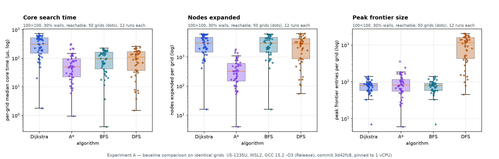
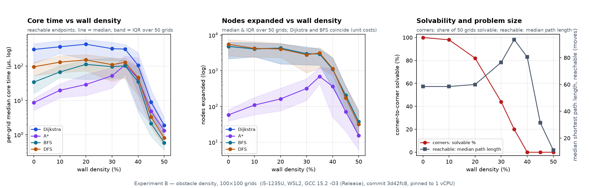
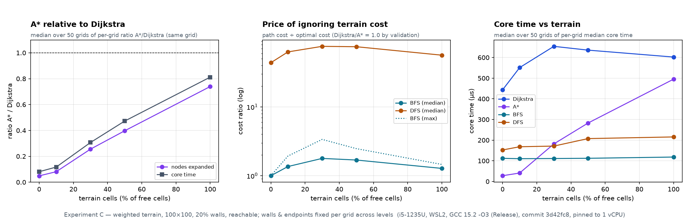
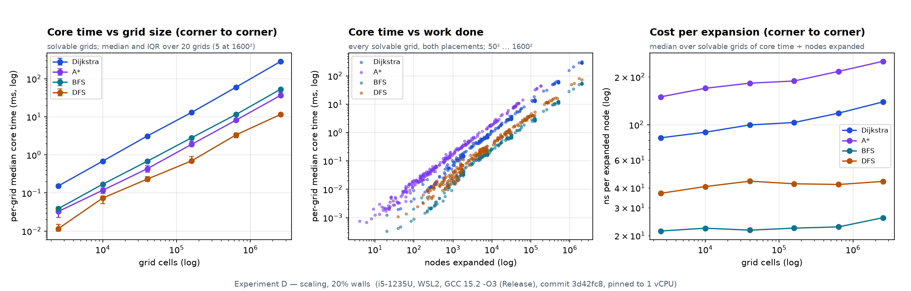
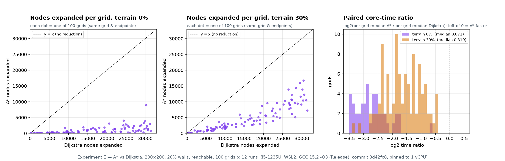
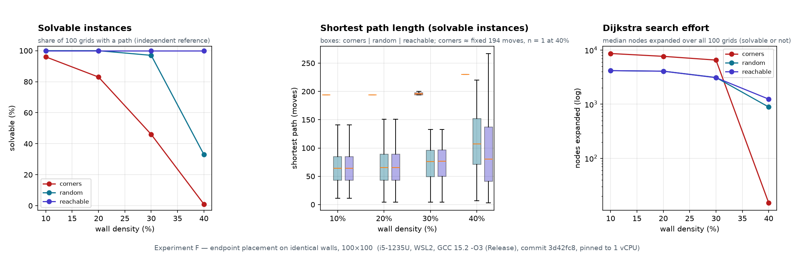
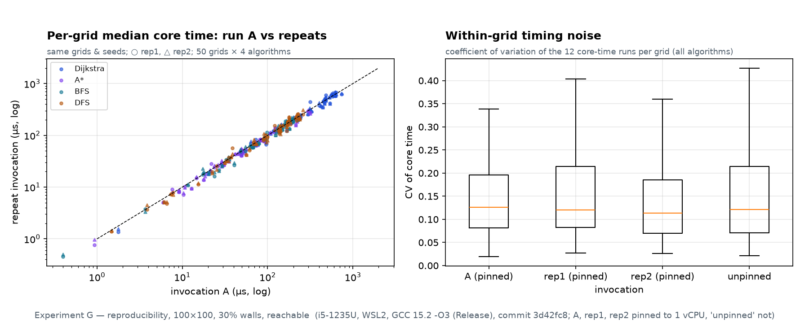

# Benchmarking study: Dijkstra, A\*, BFS and DFS on grid workloads

**Workloads:** seeded random-wall, maze-free grids from the project's own benchmark framework, commit `3d42fc8`.
**Measurements:** 82,400 timed searches on 2,970 generated grids, collected on 2026-11-20 on one laptop under WSL2.

All numbers come from [`processed/stats.md`](processed/stats.md), which [`scripts/analyze.py`](scripts/analyze.py) computes from the raw data in [`raw/`](raw/). The analysis is deterministic: re-running it reproduces `stats.md` byte for byte.

> **Post-audit revision.** An independent audit verified this study from the raw data ([`audit/README.md`](audit/README.md)). The audit confirmed every headline number. This revision corrects three factual errors (the Wilcoxon p-value statement, the timer-floor description and the BFS excess-cost range) and adds qualifications; see [§16](#16-independent-audit-and-corrections). Values marked *audit-derived* come from [`audit/audit_stats.py`](audit/audit_stats.py), not from the original analysis. The original analysis outputs (`processed/`, `plots/`) and raw data are unchanged.

---

## 1. Executive summary

**Correctness.** All 82,400 timed runs passed the framework's independent validation, a reference solver that shares no code with the searches.
- Dijkstra and A\* returned the reference minimum cost on every grid of every experiment.
- BFS returned the reference minimum number of moves on every grid.
- The independent audit regenerated all 2,970 grids bit-exactly with separately written code, and its own solvers confirmed every reported optimal cost and move count (§16). Path *structure* (adjacency, no walls, no revisits) is not recorded in the CSVs; it rests on the framework's validator alone.

**A\* versus Dijkstra (confirmatory, Experiment E).** On 200×200 grids with 20% walls and reachable endpoints, 100 grids per workload, A\* was faster on every grid.

| | No terrain | 30% terrain |
|---|---|---|
| Median per-grid core-time ratio A\*/Dijkstra (95% bootstrap CI) | **0.071 [0.057, 0.092]** | **0.319 [0.282, 0.364]** |
| Grids on which A\* was faster | 100/100 | 100/100 |
| Exact two-sided sign test and exact Wilcoxon signed-rank test p (audit-derived) | 1.6 × 10⁻³⁰ | 1.6 × 10⁻³⁰ |
| Nodes A\* expanded, as a share of Dijkstra's (median) | 4.8% | 25.4% |

The pre-registered hypothesis H1 is supported for both workloads. The original analysis reported Wilcoxon p = 3.9 × 10⁻¹⁸, which is the normal approximation (§7 E). A second full execution of the study gave 0.070 and 0.317, but its raw data were not archived in this repository (§7 G).

**Terrain weakens A\*'s advantage.** With walls and endpoints held fixed per grid, A\*'s expansion share grew from 4.9% of Dijkstra's (no terrain) to 25.5% (30% terrain) and 73.9% (every free cell weighted). A possible mechanism, not tested here, is that the heuristic stays unscaled Manhattan distance while the mean cost of entering a cell rises from 1 to 2.5 and then to 6.

**Unit-cost grids, BFS against Dijkstra.** The two expanded and discovered the same *number* of cells on every unit-cost grid (2,570 of 2,570 across all experiments). The data record counts, not which cells, so identical cell sets are not established. BFS's core time was 0.308× Dijkstra's [0.298, 0.316] (Experiment A); with equal expansion counts, heap maintenance is the likely source of the difference, though this was not isolated.

**Scaling.** Core time grows almost linearly with nodes expanded: log-log slopes 1.02–1.06 with r² ≥ 0.988 on 50² to 1600² grids, pooling both placement modes. DFS's slope depends on that pooling: 1.035 pooled, but 0.987 on corner-to-corner grids alone (§7 D). Dijkstra's cost per expansion rose from 83 to 139 ns on corner-to-corner problems as grids grew from 50² to 1600²; BFS stayed at 21–26 ns.

**Workload selection changes the answer.**
- With endpoints in the corners, the share of solvable grids fell from 98% (10% walls) to 44% (30%) and 0% (40%).
- With reachable placement, every grid is solvable, but above 40% walls the problems are tiny: median path 11 moves at 50%, and 88% of measurements were below the timer's reliable range (3.4 µs).
- At 20% walls, A\*'s expansion share was 9.4% of Dijkstra's with corner endpoints and 4.9% with reachable endpoints. The measured "A\* advantage" therefore depends on how endpoints are chosen.

**Reproducibility.**
- Workloads and all non-timing outputs were bit-identical across 4 repeat invocations of one configuration (data in this repository).
- A second full execution of all 52 configurations was likewise identical in every non-timing column. The audit verified this, but those data were **not archived** here, so this result cannot be re-checked from the repository.
- Aggregate median core times varied 3.6–6.4% between identical invocations.
- A different sample of 50 grids (another seed) shifted aggregate times by +5% to +47%, while the paired A\*/Dijkstra ratio stayed between 0.19 and 0.23.
- So the choice of grids, not timer noise, dominates the uncertainty in absolute times, and **paired ratios are far more stable than absolute times**.

## 2. Research questions

| ID | Question | Kind |
|---|---|---|
| A | How do the four algorithms compare in time, search effort, frontier and solution quality on one fixed workload? | exploratory |
| B | How does wall density change effort, runtime, frontier, success and variability? | exploratory |
| C | How does weighted terrain change behaviour and solution quality, and how much do cost-blind algorithms lose? | exploratory |
| D | How do time and per-expansion cost scale with grid size? | exploratory |
| E | Is A\* faster than Dijkstra on 200×200 grids with 20% walls, with and without terrain? Does it expand fewer nodes, and are its costs optimal? | **confirmatory, pre-registered** |
| F | How does the endpoint-placement mode change the population of problems and the measured results? | exploratory |
| G | Which outputs are reproducible, and how large is the timing variation between invocations and between grid samples? | verification |

## 3. Methodology

The full plan was written before execution: [`plan.md`](plan.md). Its file timestamp (21:33:09Z) precedes the first benchmark run (21:33:36Z), but the plan was **not committed** to version control before execution, so the pre-registration is not tamper-evident. It has been left unchanged since execution.

- **Unit of analysis: the grid.** Each grid was generated once from its seed and searched by every algorithm.
  - Every algorithm ran 1 untimed warm-up and then *R* timed runs, interleaved, with the algorithm order rotated each run.
  - Per-grid statistics are taken over those *R* runs, and across-grid statistics over the per-grid medians.
  - Repeated runs are never counted as independent observations.
- **Pairing.** All algorithms in an invocation share each grid and its endpoints. Across invocations with the same base seed (1000), walls are identical for each seed index whatever the placement mode or terrain level. Endpoints are identical across terrain levels and between `random` and `reachable` placement whenever the first draw is accepted. These properties were checked in the data, not assumed (§7).
- **Statistics:**
  - medians, IQRs and percentiles over grids;
  - 95% percentile-bootstrap CIs for medians and median ratios (10,000 resamples of grids, fixed RNG seeds);
  - a two-sided Wilcoxon signed-rank test on log ratios **only** for confirmatory Experiment E. The published p-values are SciPy's normal approximation; the audit added the exact Wilcoxon and sign-test p-values (§7 E);
  - log-log least-squares slopes for scaling.

  No significance testing was done for the exploratory experiments. No correction for multiple comparisons was applied, because none of the exploratory statistics is used to claim significance.
- **Timing:**
  - The primary metric is the per-grid median **core** time, measured after the per-cell arrays are set up.
  - End-to-end time (the whole call, including allocation and freeing) is reported alongside.
  - Per-grid medians below 100 × the calibrated timer resolution (2.7–3.8 µs) are flagged. **Correction:** contrary to the original wording here and in `plan.md`, flagged grids were *not* excluded from the published medians, confidence intervals or test.
    - They were excluded only from the expansions-per-ms figure, and were treated qualitatively for B at ≥ 45% walls.
    - In A, one grid per algorithm was flagged (grid 49 for Dijkstra, A\* and BFS; grid 14 for DFS). In E, 2 grids at 0% terrain (grids 28 and 50) and none at 30%.
    - Excluding them changes no conclusion (audit-derived, §7 A and E).

## 4. Benchmark framework and metrics

The framework was audited at commit `3d42fc8` (details in [`plan.md`](plan.md)) and **not modified**.

| Metric | Definition (from `src/search.h`) |
|---|---|
| core time | search only, from after per-cell setup to the rebuilt path (`steady_clock`) |
| end-to-end time | the whole search call, including allocating, initialising and freeing per-cell arrays |
| nodes expanded | unique cells whose neighbours were examined; the goal is not counted |
| nodes discovered | unique cells ever pushed onto the frontier, including the start |
| peak frontier | most frontier entries at once, **including stale duplicates** (Dijkstra, A\*, DFS) |
| path length / cost | moves / sum of entry costs (empty 1, sand 3, water 5, mountain 10) |
| cost ratio | path cost ÷ reference minimum cost (only for solved grids with a minimum above 0) |

Algorithm details that matter for interpretation:
- **A\*** uses the Manhattan heuristic without scaling. It is admissible because the minimum step cost is 1; ties go to the smaller *h*, then insertion order.
- **Dijkstra** breaks ties in insertion order.
- **BFS** ignores terrain.
- **DFS** explores neighbours up, right, down, left and is not optimal.

## 5. Experimental configurations

Every experiment used `taskset -c 2` (except G/unpinned), 1 warm-up per algorithm per grid, and base seed 1000 (G3: 5000). The exact commands are in [`raw/commands.log`](raw/commands.log).

| Exp | Grid | Walls | Terrain | Placement | Algorithms | Grids × runs | Timed runs |
|---|---|---|---|---|---|---|---|
| A | 100² | 30% | 0 | reachable | all 4 | 50 × 12 | 2,400 |
| B1 | 100² | 0, 10, 20, 30, 35, 40, 45, 50% | 0 | reachable | all 4 | 50 × 12 each | 19,200 |
| B2 | 100² | same densities | 0 | corners | all 4 | 50 × 4 each | 6,400 |
| C | 100² | 20% | 0, 10, 30, 50, 100% | reachable | all 4 | 50 × 12 each | 12,000 |
| D1 | 50² … 1600² | 20% | 0 | reachable | all 4 | 50/50/30/20/10/5 grids × 12/12/12/8/4/4 runs | 7,120 |
| D2 | 50² … 1600² | 20% | 0 | corners | all 4 | 20 grids (5 at 1600²) × 4 | 1,680 |
| E | 200² | 20% | 0, 30% | reachable | Dijkstra, A\* | 100 × 12 each | 4,800 |
| F | 100² | 10, 20, 30, 40% | 0 | corners, random, reachable | all 4 | 100 × 4 each | 19,200 |
| G | 100² | 30% | 0 | reachable | all 4 | 4 invocations of 50 × 12 | 9,600 |
| **Total** | | | | | | 52 invocations, 2,970 grids | **82,400** (+11,480 warm-ups) |

All 52 invocations exited 0 with status `complete`: no validation failures and no grid-generation failures. Total benchmark wall time was 66.5 s.

## 6. Environment

Full details: [`environment.md`](environment.md).

- **Machine:** Intel i5-1235U (hybrid performance/efficiency cores), Linux 6.6 WSL2 guest on Windows, 12 logical CPUs, 7.6 GiB of memory.
- **Build:** GCC 15.2 at `-O3 -DNDEBUG`, from a clean worktree of `3d42fc8`.
- **Timer:** effective resolution about 26–33 ns.
- **Not controllable from the guest:** CPU frequency and which physical core runs a virtual CPU.

## 7. Results

### A. Baseline (100×100, 30% walls, reachable, 50 grids)



| Algorithm | Core µs, median [95% CI] | p10–p90 | Expanded | Discovered | Peak frontier | Path length | Cost ratio, median (max) |
|---|---|---|---|---|---|---|---|
| Dijkstra | 314 [213, 459] | 73–615 | 3,021 | 3,084 | 80 | 76.5 | 1 (1) |
| A\* | 49 [31, 73] | 10–153 | 322 | 396.5 | 82 | 76.5 | 1 (1) |
| BFS | 95 [66, 140] | 20–193 | 3,021 | 3,084 | 80 | 76.5 | 1 (1) |
| DFS | 110 [73, 139] | 8–217 | 2,834 | 3,098 | 1,152 | 1,116 | 17.4 (670.5) |

Paired with Dijkstra, on the same grids:

| | Median core-time ratio [95% CI] | Grids faster than Dijkstra | Median expansion ratio |
|---|---|---|---|
| A\* | 0.200 [0.147, 0.252] | 50/50 | 0.142 |
| BFS | 0.308 [0.298, 0.316] | 50/50 | 1 (equal expansion count on every grid) |
| DFS | 0.317 [0.197, 0.454] | 43/50 | 0.848 (range 0.03–351) |

All algorithms solved 50/50 grids. One grid per algorithm was near the timer floor: grid 49 for Dijkstra, A\* and BFS, and grid 14 for DFS. These grids are included in the table.

Without them (audit-derived), the paired medians barely move:

| Ratio to Dijkstra | Median | 95% CI | Grids |
|---|---|---|---|
| A\* | 0.199 | [0.143, 0.252] | 49 |
| BFS | 0.309 | [0.298, 0.317] | 49 |
| DFS | 0.317 | [0.197, 0.446] | 48 |

The spread *between grids* is large. Dijkstra's per-grid medians range from 73 to 615 µs (p10–p90), because random endpoint pairs vary in distance. The paired ratios are much tighter than the absolute times. DFS is fast here because it stops at the first path it finds; that path has a median of 1,116 moves against 76.5 optimal, and in the worst case costs 670× the optimum.

### B. Obstacle density (100×100)



**B1, reachable placement** (medians over 50 grids):

| Walls | Dijkstra µs | A\* µs | BFS µs | DFS µs | Dijkstra expanded | A\* expanded | Path length | Placement draws, median (max) | Grids near floor (of 200) |
|---|---|---|---|---|---|---|---|---|---|
| 0% | 306.5 | 8.7 | 34.3 | 95.7 | 4,851 | 58.5 | 58.5 | 1 (1) | 3 |
| 10% | 367.5 | 19.8 | 67.5 | 130.9 | 4,116 | 110 | 58.5 | 1 (1) | 2 |
| 20% | 435.8 | 29.3 | 112.9 | 152.0 | 4,350 | 163.5 | 60 | 1 (1) | 9 |
| 30% | 323.8 | 52.3 | 96.6 | 110.7 | 3,021 | 322 | 76.5 | 1 (2) | 4 |
| 35% | 314.1 | 108.6 | 102.2 | 129.4 | 2,973 | 696.5 | 93.5 | 1 (2) | 5 |
| 40% | 105.9 | 44.0 | 35.0 | 46.3 | 1,110 | 368 | 80.5 | 3 (21) | 25 |
| 45% | 8.9 | 4.9 | 2.1 | 3.3 | 206.5 | 72 | 31.5 | 19 (128) | 77 |
| 50% | 1.9 | 1.3 | 0.6 | 0.8 | 37.5 | 15.5 | 11 | 90 (406) | 176 |

**B2, corner placement**, solvable grids out of 50, by wall density:

| | 0% | 10% | 20% | 30% | 35% | 40% | 45% | 50% |
|---|---|---|---|---|---|---|---|---|
| Solvable | 50 | 49 | 41 | 22 | 10 | 0 | 0 | 0 |

Every algorithm solved exactly the solvable grids.

**Within-grid noise** (median CV of the 12 runs) was 0.06–0.15 up to 35% walls, then 0.15–0.41 at 40–50%, where most searches fall near the timer floor.

Interpretation:
- **A\*'s search effort rises with density** (59 → 697 expansions from 0% to 35% walls), as walls force detours away from the straight line the heuristic points to.
- **Dijkstra and BFS effort falls with density**, because the open region shrinks.
- **Above 35% walls, the problem population itself changes.** Rejection sampling needs more draws (median 90 at 50%), accepted pairs sit in small clusters, and the median path falls to 11 moves. The drop in time above 35% therefore reflects a different, smaller population of problems, not easier search on equal problems.
- **Timing at 45–50% walls is not interpretable:** 77 and 176 of 200 per-grid values are near the floor.
- **With corners,** solvability collapses between 20% and 40% walls. On unsolvable corner grids, the search ends once it has exhausted the start's region: a median of 8,643 cells at 10% walls but only 18 at 40%, where the corner is sealed in.

### C. Weighted terrain (100×100, 20% walls, reachable, 50 grids)



Walls, start, end and open-cell count were verified identical for every grid across all five terrain levels, so terrain is a within-grid factor.

| Terrain *p* | Mean free-cell cost | Optimal cost | A\*/Dijkstra expanded | A\*/Dijkstra core time [95% CI] | Dijkstra µs | A\* µs | Dijkstra ns/exp. | Dijkstra peak frontier | BFS cost ratio, median (max) | DFS cost ratio |
|---|---|---|---|---|---|---|---|---|---|---|
| 0 | 1.0 | 60 | 0.049 | 0.081 [0.072, 0.100] | 443.5 | 27.8 | 100 | 97 | 1.00 (1.00) | 43.9 |
| 0.1 | 1.5 | 64 | 0.081 | 0.117 [0.092, 0.139] | 551.3 | 40.9 | 124 | 137 | 1.36 (1.93) | 62.9 |
| 0.3 | 2.5 | 88.5 | 0.255 | 0.307 [0.251, 0.419] | 654.1 | 181.8 | 150 | 174 | 1.78 (3.37) | 75.8 |
| 0.5 | 3.5 | 132.5 | 0.397 | 0.472 [0.366, 0.586] | 635.8 | 282.9 | 153 | 176 | 1.69 (2.47) | 74.9 |
| 1.0 | 6.0 | 300 | 0.739 | 0.812 [0.723, 0.885] | 602.3 | 495.1 | 139 | 123.5 | 1.28 (1.46) | 56.4 |

- **Optimality:** A\* and Dijkstra returned equal, reference-optimal costs on every grid at every level.
- **A\*'s advantage decays steadily with terrain.** At *p* = 1 it still saves about 26% of expansions. *Possible mechanism (hypothesis, not tested):* the heuristic is fixed at 1 per move while real costs per move rise, so it becomes relatively less informative. A scaled-heuristic control would be needed to test this (§14).
- **Dijkstra's time rises with terrain** (444 → 654 µs) even though its expansions fall slightly, and not monotonically (they rise again at *p* = 1). Its cost per expansion rises from 100 to about 150 ns while its peak frontier nearly doubles (97 → 174; 123.5 at *p* = 1). *Possible mechanism (hypothesis, not tested):* weighted edges cause more distance improvements, so the heap holds more entries, including stale ones. The data show only the correlation and cannot separate stale from live entries.
- **The price of ignoring weights.** BFS keeps the fewest-moves path, a median of 60 moves at every level. **Correction:** across the four weighted levels, its median excess cost over the optimum was **28–78%**, not 36–78% as originally stated. By level:

  | Terrain | 10% | 30% | 50% | 100% |
  |---|---|---|---|---|
  | Median excess cost | 36.0% | 78.4% | 69.0% | 27.7% |
  | Maximum cost ratio | 1.93× | 3.37× | 2.47× | 1.46× |

  The excess is not monotone in *p*, and this study does not establish why.
  - The original text suggested that cell costs vary least relative to their mean when every cell is weighted (entry-cost CV 1.12 at *p* = 0.3, 0.49 at *p* = 1).
  - The 10% result contradicts that as a sole explanation: entry-cost CV is highest there (1.18) while the excess (36%) is lower than at 30% or 50%. The explanation has therefore been withdrawn.
- **BFS's core time is unaffected by terrain** (110–118 µs), since its work does not depend on costs.
- **No cross-objective ranking.** These BFS and DFS cost ratios measure the price of ignoring weights. They are not a ranking of BFS or DFS against cost-optimal algorithms, which solve a different problem on weighted grids.

### D. Grid scaling (20% walls)



**Corner to corner** (solvable grids; medians):

| Side | Solvable / grids | Path length | Dijkstra ms | A\* ms | BFS ms | DFS ms | Dijkstra ns/exp. | A\* ns/exp. | BFS ns/exp. | DFS ns/exp. |
|---|---|---|---|---|---|---|---|---|---|---|
| 50 | 16/20 | 94 | 0.153 | 0.033 | 0.039 | 0.012 | 83 | 150 | 21 | 37 |
| 100 | 17/20 | 194 | 0.685 | 0.118 | 0.170 | 0.073 | 90 | 170 | 22 | 41 |
| 200 | 18/20 | 394 | 3.12 | 0.432 | 0.679 | 0.231 | 100 | 183 | 22 | 44 |
| 400 | 17/20 | 794 | 13.1 | 1.89 | 2.82 | 0.698 | 103 | 189 | 22 | 42 |
| 800 | 18/20 | 1,594 | 60.2 | 8.19 | 11.5 | 3.36 | 118 | 217 | 23 | 42 |
| 1600 | 5/5 | 3,194 | 284.4 | 36.6 | 52.9 | 11.5 | 139 | 251 | 26 | 44 |

**Core time against nodes expanded** (log-log least squares; all solvable grids of both placements with at least 1,000 expansions):

| | Dijkstra | A\* | BFS | DFS |
|---|---|---|---|---|
| Slope [95% CI] | 1.060 [1.053, 1.067] | 1.052 [1.042, 1.063] | 1.016 [1.007, 1.025] | 1.035 [1.019, 1.051] |
| r² | 0.998 | 0.998 | 0.996 | 0.988 |
| Grids | 215 | 95 | 215 | 202 |

- **Near-linear in the work done.** For a fixed algorithm, core time is almost proportional to nodes expanded across 3 orders of magnitude of grid size.
- **Sensitivity to pooling (audit-derived).** The slopes above pool both placement modes. Fitted separately (OLS):

  | | Pooled | Corners only | Reachable only | Theil–Sen, pooled |
  |---|---|---|---|---|
  | Dijkstra | 1.060 | 1.064 | 1.080 | 1.057 |
  | A\* | 1.052 | 1.066 | 1.046 | 1.053 |
  | BFS | 1.016 | 1.017 | 1.038 | 1.010 |
  | DFS | **1.035** | **0.987** | **1.053** | 1.019 |

  The DFS exponent depends on how the placements are pooled, so "slightly superlinear" is not established for DFS. The OLS confidence intervals in the table above assume the pooled grids are a homogeneous sample.
- **The small excess over 1 tracks per-expansion cost.**
  - The heap-based algorithms' cost per expansion grows with size: Dijkstra 83 → 139 ns, A\* 150 → 251 ns. This is consistent with a logarithmic heap factor and larger working sets, though the study did not separate the two.
  - BFS stays at 21–26 ns and DFS at 37–44 ns.
- **A\* does more work per expansion than Dijkstra** (about 1.8×). It discovers more cells per expansion and keeps a larger heap relative to the cells it expands. It wins only because it expands far fewer cells.
- **Reachable placement** (full table in `processed/stats.md`) does not give a clean size series: random endpoint distances make the median path non-monotonic in grid size (e.g. 170 moves at 400² against 125 at 200²). The corner series is the meaningful scaling measurement.
- **Small sample at 1600²:** only 5 grids, so its medians are imprecise.

### E. A\* against Dijkstra: confirmatory (200×200, 20% walls, reachable, 100 grids × 12 runs)



| Terrain | Median core-time ratio A\*/Dijkstra [95% bootstrap CI] | Geometric mean | Wilcoxon p (normal approx.; exact: 1.6e-30) | A\* faster | **H1** | Median expansion ratio [CI] | A\* fewer expansions (max ratio) | Median peak-frontier ratio | Median end-to-end ratio | **H3: equal & optimal cost** |
|---|---|---|---|---|---|---|---|---|---|---|
| 0% | **0.0706** [0.057, 0.092] | 0.0712 | 3.9e-18 | 100/100 | **supported** | 0.048 [0.039, 0.060] | 100/100 (0.30) | 1.60 | 0.100 | **yes, all 100 grids** |
| 30% | **0.319** [0.282, 0.364] | 0.319 | 3.9e-18 | 100/100 | **supported** | 0.255 [0.233, 0.284] | 100/100 (0.55) | 1.11 | 0.334 | **yes, all 100 grids** |

- **H1** (the median time ratio is below 1) is supported for both terrain levels under the pre-registered rule: the CI lies entirely below 1 and p < 0.05.
- **H2** (fewer expansions on most grids) holds on all 100 grids at both levels.
- **H3** holds: every A\* and Dijkstra path cost equalled the independent reference minimum.
- **Correction (p-values).** The published p = 3.9 × 10⁻¹⁸ is SciPy's **normal-approximation** Wilcoxon p, not the smallest possible p for n = 100, as the original text claimed.
  - Every one of the 100 log ratios is negative. The **exact** two-sided Wilcoxon p and the exact two-sided **sign test** p are therefore both 2 × 0.5¹⁰⁰ ≈ **1.6 × 10⁻³⁰** (audit-derived), which is the smallest attainable p for n = 100.
  - The decision rule (CI below 1 and p < 0.05) gives the same outcome with either value.
- **Interpreting the tests.**
  - The Wilcoxon signed-rank test assesses whether the log ratios are distributed symmetrically about 0 (a pseudo-median shift), and its location interpretation assumes symmetric differences.
  - H1 is a statement about the **median** ratio, which the **sign test** addresses directly, without a symmetry assumption.
  - Both reject here because all signs agree. The **effect sizes** (the median ratio and its bootstrap CI) are the informative quantities.
- **Timer-floor sensitivity (audit-derived).**
  - At 0% terrain, 2 of the 100 grids (28 and 50) were flagged near the timer floor and were included in the published figures. Excluding them gives a median of **0.0690**, 95% CI [0.056, 0.090] (n = 98; percentile bootstrap, 20,000 resamples, RNG seed 20261121; the audit's own run gave [0.056, 0.089]).
  - At 30% terrain no grid was flagged.
  - H1's conclusion is unchanged.
- **Peak frontier:** A\*'s peak was *larger* than Dijkstra's on most grids (median ratio 1.60 without terrain). Fewer expansions did not mean a smaller heap at its peak.
- **End-to-end time:** end-to-end ratios (0.100, 0.334) are closer to 1 than core ratios, because both algorithms pay the same O(cells) setup.
- **Second execution:** a second full run of the study gave 0.0697 [0.059, 0.096] and 0.317 [0.274, 0.360], with H1 supported in both. The audit confirmed these medians against that run's data, but **the data were not archived in this repository**, so this replication cannot be verified from the repository alone.

### F. Endpoint placement (100×100, identical walls across placements, 100 grids)



Walls were verified identical across placements for each seed via equal open-cell counts.

| Walls | Placement | Solvable /100 | Path length median (p10–p90), solvable | Dijkstra expanded (all grids) | A\*/Dijkstra expansion ratio (solvable) | Draws, median (max) |
|---|---|---|---|---|---|---|
| 10% | corners | 96 | 194 (194–194) | 8,641 | 0.070 | – |
| 10% | random | 100 | 64 (29–115) | 4,166 | 0.031 | 1 |
| 10% | reachable | 100 | 64 (29–115) | 4,166 | 0.031 | 1 (1) |
| 20% | corners | 83 | 194 (194–194) | 7,661 | 0.094 | – |
| 20% | random | 100 | 65.5 (26–109) | 4,075 | 0.049 | 1 |
| 20% | reachable | 100 | 65.5 (26–109) | 4,075 | 0.049 | 1 (1) |
| 30% | corners | 46 | 196 (194–198) | 6,534 | 0.102 | – |
| 30% | random | 97 | 76 (31–110) | 3,112 | 0.129 | 1 |
| 30% | reachable | 100 | 76.5 (31–110) | 3,092 | 0.130 | 1 (2) |
| 40% | corners | 1 | 230 (n = 1) | 15 | 0.52 (n = 1) | – |
| 40% | random | 33 | 107 (22–198) | 887 | 0.447 | 1 |
| 40% | reachable | 100 | 80.5 (18–187) | 1,241 | 0.383 | 3 (37) |

- **Up to 20% walls, `random` and `reachable` are the same population.** Every first draw is connected, so both choose the same endpoints (the identical rows confirm this).
- **At 30% they diverge slightly** (3 grids redrawn). **At 40% they are clearly different populations:** reachable is solvable 100/100 against random's 33/100, with a shorter median path (80.5 against 107 for random's solvable grids) and a lower expansion ratio. The conditioning selects for pairs inside the larger connected regions.
- **Corners pose a different problem altogether:** a fixed path of about 194 moves, while it stays solvable. That gives a larger Dijkstra search effort and a weaker *relative* A\* advantage (0.07–0.10 against 0.03–0.05 at ≤ 20% walls).
- **Statements about "A\*'s advantage" are therefore population-specific.** They must name the placement mode.

### G. Reproducibility (A's workload)



**G1. Determinism.** All 30 non-timing columns of the per-run CSV (2,400 rows) were identical in rep1, rep2 and the unpinned run, compared with A, and so were all grid hashes. Separately, the **entire study** was executed a second time into a temporary directory, and 52/52 per-run CSVs were identical in every non-timing column; the audit confirmed this. That second execution's data were **not archived** in this repository, so this part of the evidence cannot be re-checked from the repository. The repeat invocations rep1, rep2 and unpinned, which are archived, support the same determinism claim for one configuration.

**Timing variation** (across-grid median of per-grid median core time, µs):

| | Dijkstra | A\* | BFS | DFS |
|---|---|---|---|---|
| A / rep1 / rep2 (pinned) | 313.8 / 297.6 / 296.9 | 49.4 / 46.3 / 48.7 | 95.4 / 90.8 / 89.7 | 110.5 / 108.9 / 106.5 |
| Spread across the 3 pinned invocations | 5.7% | 6.4% | 6.3% | 3.6% |
| Per-grid spread across invocations, median (p90) | 11% (27%) | 10% (23%) | 12% (23%) | 15% (30%) |
| Unpinned | 303.7 | 45.6 | 92.9 | 111.2 |
| Within-grid CV, median: pinned A vs unpinned | 0.093 vs 0.094 | 0.118 vs 0.122 | 0.119 vs 0.113 | 0.148 vs 0.144 |
| Seed 5000 (different 50 grids) | 338.6 (+8%) | 72.8 (+47%) | 109.9 (+15%) | 115.5 (+5%) |

Paired A\*/Dijkstra median core ratio per invocation: A 0.200, rep1 0.192, rep2 0.200, unpinned 0.208, seed 5000 0.230. All bootstrap CIs lie within [0.142, 0.260].

- **Deterministic:** workload generation and all non-timing results, as shown by the archived repeat invocations, and independently by the audit's bit-exact regeneration of all 2,970 grids.
- **Measurement noise:** timing repeats to within about 6% at the aggregate level but only about 10–15% per grid. Single-grid timing comparisons below that level are not meaningful.
- **Pinning:** in the single observed comparison (one unpinned invocation against pinned A), the within-grid CV did not differ detectably (Mann–Whitney p = 0.29–0.94 per algorithm, audit-derived).
  - This is not evidence that pinning never matters.
  - Pinning acted only inside the WSL2 guest; host scheduling was uncontrolled.
  - One invocation cannot show a small effect.
- **Grid sampling:** a different sample of grids moved absolute aggregates by up to 47% (A\*), far more than measurement noise, while paired ratios moved little. Report paired ratios with CIs; treat absolute times as properties of a specific sample.

## 8. Statistical summary

| Claim | Evidence | Strength |
|---|---|---|
| A\* < Dijkstra in core time (200², 20% walls, reachable) | ratio 0.071 [0.057, 0.092] and 0.319 [0.282, 0.364]; 100/100 grids; exact sign test p ≈ 1.6e-30 (normal-approx. Wilcoxon 3.9e-18); 0.069 without floor-flagged grids; second execution agreed (data not archived) | confirmatory, strong |
| A\* expands fewer nodes than Dijkstra | 100/100 grids in E; 50/50 in A; all levels in C | deterministic, observed on every grid |
| Dijkstra/A\* optimal; BFS move-optimal | independent validation of all 82,400 runs | verified |
| A\* advantage shrinks with terrain | expansion ratio 0.049 → 0.739 within the same 50 grids | exploratory, consistent monotone trend; mechanism untested |
| BFS ≈ 0.31× Dijkstra on unit grids, equal expansion counts | 0.308 [0.298, 0.316], 50/50; equal counts on 2,570/2,570 unit grids (cell identity not recorded) | exploratory, tight CI |
| Core time ~ linear in expansions | slopes 1.02–1.06, r² ≥ 0.988 (pooled); DFS 0.987–1.053 by pooling | exploratory |
| Placement changes measured results | F tables; identical walls | exploratory, large differences |
| Timing noise ≈ 6% aggregate, 10–15% per grid | G | descriptive, one machine |

## 9. Algorithm-specific interpretation

- **Dijkstra.** Uniform-cost search. On unit-cost grids its expansion and discovery *counts* equal BFS's on every grid; FIFO tie-breaking makes identical expansion order expected, but cell identity is not recorded. The roughly 3.2× extra time is most plausibly heap maintenance (not isolated). With weights it pays more per expansion (larger heap) but stays optimal.
- **A\*.** The unscaled Manhattan heuristic is admissible and consistent; the 100% optimality agreement in C and E confirms the implementation preserved optimality. Its benefit is largest when step costs are close to the heuristic's per-move estimate of 1, and shrinks as terrain raises real costs. It costs about 1.8× more per expansion than Dijkstra, and its peak frontier is often larger.
- **BFS.** The fastest per expansion (about 22 ns) and move-optimal. On weighted grids it optimises the wrong objective; its paths cost up to 3.4× the optimum here.
- **DFS.** Not optimal (median 17× and up to 670× the optimal cost in A). It can be fast when it reaches the goal early, but its effort is erratic (expansion ratio to Dijkstra 0.03–351 in A). Its peak frontier counts stale stack duplicates, so it is a memory figure, not a count of distinct pending cells.

## 10. Limitations

- **Single machine:** one laptop CPU under WSL2. Frequency, turbo and the host's choice of performance or efficiency cores were uncontrolled, so absolute times will differ elsewhere.
- **Timer floor:** small searches (≥ 45% walls with reachable placement) fall under the timer floor, so their timing is not interpretable.
- **Allocation inside end-to-end time:** each run allocates fresh memory, so end-to-end time includes allocator behaviour. No reused-workspace mode exists in the framework.
- **Scope:** only 4-connected grids, one heuristic (unscaled Manhattan), fixed terrain costs, random-wall and corner/random/reachable workloads. Mazes were not studied here.
- **Small samples:** 1600² used only 5 grids; corner placement at 40% walls left 1 solvable grid.
- **Exploratory experiments** report descriptive statistics only.

## 11. Threats to validity

- **Internal:**
  - Timing noise of 10–15% per grid. Mitigated by 12 runs per grid, medians, paired ratios and floor flags.
  - Interleaving protects against drift but leaves caches partly cold.
  - Within an invocation, all algorithms share the same thermal and frequency conditions, which favours paired comparisons over cross-invocation comparisons of absolute times.
- **Construct:**
  - "Core time" includes frontier growth.
  - "Peak frontier" includes stale entries.
  - The cost ratio is undefined when start equals end (never occurred here).
- **Selection:**
  - Reachable placement conditions on connectivity, so B1 above 35% walls and F at 40% compare different populations (shown, not corrected).
  - Experiments share seeds, so B, C, F and G are coupled: they reuse the same wall layouts. They are paired across scenarios, not independent samples.
- **Statistical:**
  - Bootstrap CIs with 5 grids (1600²) are unreliable.
  - No multiple-comparison correction, by design: only E is inferential.
  - E's two hypotheses were each tested once at α = 0.05.
  - **Timer floor:** flagged grids were kept in the published timing statistics, contrary to the plan's wording. Sensitivity analysis shows no material effect (§3, §7 A and E).
  - **Test choice:** H1 is about a median, which the sign test matches directly; the pre-registered Wilcoxon test additionally assumes symmetry (§7 E).
- **Provenance:**
  - The plan was not committed before execution, so the pre-registration is not tamper-evident.
  - The second full execution's raw data were not archived.
  - The hypotheses for E were informed by earlier exploratory runs in this project, which had already shown A\*/Dijkstra ratios of about 0.2 on 100×100 grids. E is confirmatory in procedure, but its outcome was not surprising.
- **External:** results hold for these synthetic grid models and this implementation only. They are not evidence about road networks, octile movement, or other heuristics.

## 12. Reproducing the study

```bash
# 1. Build the exact commit (a clean worktree keeps git_dirty_at_build=false)
git worktree add --detach ../pf-3d42fc8 3d42fc8
cmake -S ../pf-3d42fc8 -B ../pf-3d42fc8/build -DCMAKE_BUILD_TYPE=Release
cmake --build ../pf-3d42fc8/build -j && ctest --test-dir ../pf-3d42fc8/build

# 2. Run all experiments (about 70 s here); writes CSVs + .meta.json + commands.log
BIN=../pf-3d42fc8/build/pathfinding OUT=experiments/raw-repro experiments/scripts/run_experiments.sh

# 3. Analyse (pandas, numpy, scipy, matplotlib)
python3 experiments/scripts/analyze.py experiments/raw-repro experiments/repro-out
```

Requirements:
- **Benchmark runs:** bash, `taskset` (util-linux), `bc` (used to record wall times in `commands.log`) and `gzip`.
- **Analysis:** Python 3 with pandas, NumPy, SciPy and Matplotlib.

Notes:
- Expect identical non-timing data and different absolute times.
- The orchestrator refuses to overwrite an existing experiment directory unless `FORCE=1`, and pins to `CPU=2` by default.

What each result can be checked against:

| Result | Artifacts needed | In this repository? |
|---|---|---|
| The original study (all statistics in this report) | `raw/` + `scripts/analyze.py` | **Yes**. `python3 experiments/scripts/analyze.py` regenerates `processed/` and `plots/` byte-identically (verified with the library versions in `environment.md`). |
| Audit-derived figures (marked in the text) | `raw/` + `audit/audit_stats.py` | **Yes** |
| Independent grid regeneration and correctness check | `raw/` + `audit/regen.py`, `audit/verify_grids.py` | **Yes** |
| The second full execution (§7 G1, §7 E "second execution") | its raw CSVs | **No**. Not archived; only the summary figures quoted here remain. |
| A new replication | a build of `3d42fc8` + the commands above | Yes: produces new data, comparable in non-timing columns |

## 13. Conclusions

On these workloads and this machine:
1. **A\* is substantially faster than Dijkstra on 200×200 grids with 20% walls and reachable endpoints:** about 14× by median core-time ratio without terrain, and about 3.1× with 30% weighted terrain. It was faster on every grid, and its paths were always optimal. The advantage comes from expanding far fewer cells; per expansion, A\* costs more than Dijkstra.
2. **The size of A\*'s advantage depends on the workload.** It shrinks as terrain makes the unit heuristic less informative, and it differs by endpoint-placement mode. No single "A\* is N× faster" figure is meaningful without the workload.
3. **On unit-cost grids, BFS expanded the same number of cells as Dijkstra on every grid and ran about 3× faster.** On weighted grids it returns paths costing up to 3.4× the optimum.
4. **DFS is not a shortest-path method** (paths up to 670× the optimal cost) and has erratic effort.
5. **Core time scales almost linearly with nodes expanded;** heap-based searches get somewhat more expensive per expansion on larger grids.
6. **Workload construction matters as much as the algorithm.** Corner endpoints are mostly unsolvable from 30% walls; reachable endpoints above 40% walls are tiny problems below the timer's reliable range.
7. **The framework's workloads and non-timing results are deterministic.** This is shown by the archived repeat invocations and by the audit's bit-exact regeneration of all grids. Paired ratios are stable. Absolute times vary about 6% between runs and much more between grid samples.

## 14. Future experiments

- A controlled-hardware rerun (bare-metal Linux, fixed frequency, isolated performance core) to separate platform noise from algorithmic effects.
- A scaled A\* heuristic (multiplied by the minimum or mean terrain cost) to test the explanation in C; this would be a separate framework change.
- Maze workloads (`--scenario maze`) and larger 1600² samples.
- A reused-workspace timing mode, to separate allocator cost from end-to-end time.
- Larger sample sizes for the corners/random/reachable comparison at 35–45% walls, where the populations diverge.

## 15. Deviations from the plan

- **No experiments were skipped and no sample sizes were reduced.** All 52 invocations ran as planned, and the timed-run count (82,400) matches the plan's configurations.
- **Analysis-code fixes after the first execution:** a plotting bug (a missing DFS column in C's chart) and chart layout and labels. They changed no data or statistics.
- **Added after seeing the data (exploratory):**
  - Dijkstra's peak frontier, ns/expansion and A\*'s peak frontier in C's table, added to explain the rising Dijkstra time;
  - the B noise (CV) table;
  - the analysis script's optional input and output directory arguments.
- **Also added:** the full-study second execution (§7 G1). It was not in the plan, and its data were not archived.
- **Timer-floor handling deviated from the plan.** `plan.md` says flagged grids are "not used for timing conclusions"; in the analysis they were kept in medians, CIs and the test (§3). `plan.md` itself is left unchanged.
- **Not recorded:** the orchestration script does not save the benchmark's console summary, which `--quiet` still prints. The same information is in the `*.summary.csv` files, so the script was left exactly as executed.

## 16. Independent audit and corrections

An independent audit re-derived the study's results from the raw data, without relying on this report or `scripts/analyze.py`. Summary, scope and limitations: [`audit/README.md`](audit/README.md). In brief:

**Verified**
- All 52 invocations match `plan.md`: configurations, seeds, grids, runs and warm-up.
- All 82,400 runs passed validation; run order was balanced; non-timing metrics were deterministic.
- An independent reimplementation regenerated all 2,970 grids bit-exactly (fingerprints, endpoints, placement attempts) and confirmed every optimal cost and move count.
- Every headline statistic recomputes from the raw per-run data.

**Corrected in this revision**
1. **Wilcoxon p.** "3.9 × 10⁻¹⁸ … the smallest possible p for n = 100" was wrong: 3.9 × 10⁻¹⁸ is the normal approximation. The exact Wilcoxon and sign-test p is about 1.6 × 10⁻³⁰, which is the smallest attainable (§7 E).
2. **Timer-floor exclusion.** "Flagged values are … excluded from timing conclusions" was wrong: they were retained in the medians, CIs and test. Affected: A, 1 grid per algorithm; E, 2 grids at 0% terrain. Excluding them gives E = 0.0690 [0.056, 0.090]; no conclusion changes (§3, §7 A, §7 E).
3. **BFS excess-cost range.** "36–78%" was wrong; the correct range is 28–78% (§7 C).

**Qualified in this revision**
- **Equal counts, not cells:** equal BFS/Dijkstra expansion counts do not establish identical cell sets.
- **Withdrawn explanation:** the BFS-excess explanation based on cost variability, contradicted at 10% terrain.
- **Hypotheses:** the A\* and Dijkstra terrain mechanisms are now labelled as untested hypotheses.
- **DFS slope:** its scaling exponent depends on pooling (1.035 pooled, 0.987 corners only).
- **Pinning:** the pinning conclusion is limited to the single observed comparison.
- **Archiving and pre-registration:** the second execution's data are not archived, and the plan was not committed before execution, so the pre-registration is not tamper-evident.
- **Test choice:** the sign test, not the Wilcoxon test, matches a hypothesis about the median.

**Unchanged:** `raw/`, `processed/`, `plots/`, `plan.md` and the scripts in `scripts/` are exactly as produced by the original study. All corrections are confined to this report and the documentation, and audit-derived figures are labelled as such.
